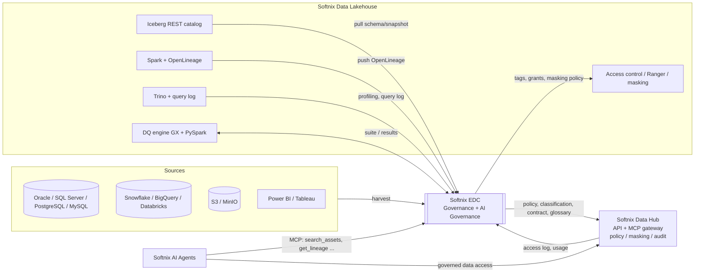
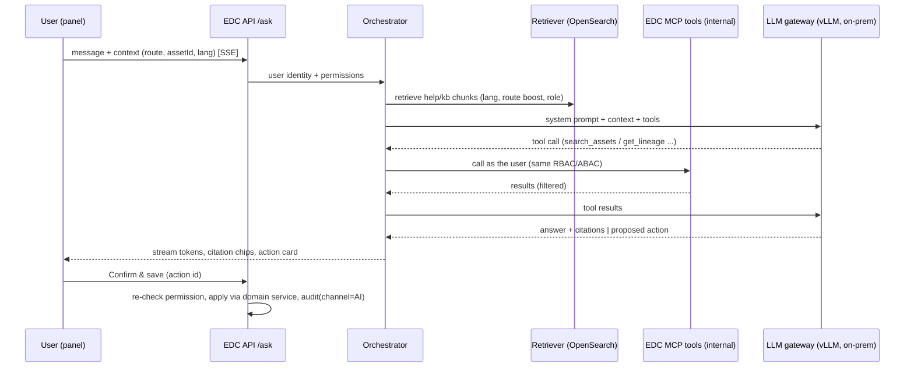
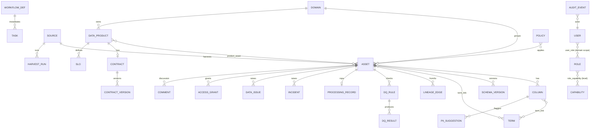
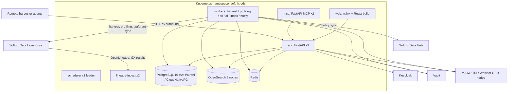

# PRD — Softnix Enterprise Data Catalog (EDC1) · Implementation Spec

| รายการ | ค่า |
| --- | --- |
| เวอร์ชัน | v2.0 (Implementation) · Draft for review |
| วันที่ | 24 ต.ค. 2026 |
| เจ้าของเอกสาร | Rujirapong R. (Softnix) |
| ผู้อ่านหลัก | Product, Tech Lead, Backend/Frontend/Data Engineer, QA, DevOps |
| เอกสารต้นทาง | [`PRD_Reference.md`](./PRD_Reference.md) (PRD v1.1 QbD, 13 ต.ค. 2026) และ GUI prototype ใน repo นี้ (`src/`, `help-content/`) |
| สถานะเอกสาร | **ฉบับหลัก (source of truth) สำหรับ developer** — `PRD_Reference.md` (v1.1) ใช้อ้างอิงที่มาเท่านั้น หากขัดกันให้ยึดเอกสารนี้ |
| สถานะ | รอพี่ทอมรีวิว · คำถามเปิดอยู่ในหัวข้อ 22 |

## 0. วิธีอ่านเอกสารนี้

PRD v1.1 บอกว่า **ต้องการอะไร** เอกสารนี้บอกว่า **จะสร้างอย่างไร** โดยยึดสิ่งที่ GUI prototype ทำอยู่จริงเป็นหลัก แล้วแปลงเป็น spec ที่ developer ลงมือได้: หน้าจอ, route, สิทธิ์, data model, API, connector, สถาปัตยกรรม และแผนส่งมอบ

- **ID ความต้องการ** ใช้ ID เดิมจาก PRD v1.1 เสมอเมื่อมี (เช่น `HRV-08`, `CLS-03`, `ASK-04`) เพราะ GUI และ Help content อ้าง ID เหล่านี้อยู่แล้ว ID ใหม่ที่เอกสารนี้เพิ่มจะติดป้าย *(ใหม่ v2.0)*
- **ป้ายที่มา** ในแต่ละหัวข้อ:
  - **[GUI]** = เห็นใน prototype จริง (route, component, form, mock data, help content)
  - **[v1.1]** = มาจาก PRD v1.1 แต่ GUI ยังไม่ได้แสดง หรือแสดงบางส่วน
  - **[เสนอ]** = ผู้เขียนอนุมาน/แนะนำเพิ่ม ต้องยืนยันก่อนลงมือ
- **Priority**: **M** = Must, **S** = Should, **C** = Could · **Phase**: MVP / v1 / v2 (หัวข้อ 20)
- ภาษา: เนื้อหาเป็นภาษาไทย ใช้ศัพท์เทคนิคภาษาอังกฤษตามที่ใช้ในโค้ดและ UI

### 0.1 สารบัญ

1. Vision และสรุป · 2. ขอบเขตและสิ่งที่ไม่ทำ · 3. ตำแหน่งในกลุ่มผลิตภัณฑ์ Softnix · 4. Personas และ RBAC · 5. Information architecture และ global UI · 6. Functional requirements รายหน้า (user story + acceptance criteria) · 7. Metadata harvest connectors · 8. Lineage · 9. Data Quality, Contract, Certification · 10. Observability และ Alerting · 11. PDPA, PII classification · 12. Policy, masking, access governance · 13. Audit trail · 14. Search และ Ask Softnix (RAG) · 15. i18n · 16. Data model · 17. API spec · 18. Non-functional requirements · 19. สถาปัตยกรรมและ tech stack · 20. แผนส่งมอบ · 21. Gap list: prototype → production · 22. คำถามเปิด · 23. ความเสี่ยง · ภาคผนวก

---

## 1. Vision และสรุปสำหรับผู้บริหาร

**Vision:** EDC คือ "ทะเบียนข้อมูลกลางที่มีธรรมาภิบาล" ขององค์กร ที่ metadata ไหลเข้าอัตโนมัติจาก Softnix Data Lakehouse และระบบอื่น ให้คนเติมเฉพาะสิ่งที่เครื่องทำไม่ได้ (ความหมาย เจ้าของ การอนุมัติ) และเป็นแหล่งความจริงด้าน **Data Governance + AI Governance** ที่ทั้งคนและ AI agent ใช้ร่วมกันได้ภายใต้สิทธิ์ชุดเดียว

จุดยืนของ Softnix ที่ EDC ต้องสะท้อน:

1. **Data Governance ครบวงจร**: ownership, glossary, classification, PDPA, data contract, DQ, certification, audit
2. **AI Governance**: AI ทุกอย่างเป็น "ข้อเสนอ" ที่คนยืนยัน (human-in-the-loop), privacy guard, model on-prem, audit ทุก prompt/tool call, MCP server ที่กรองสิทธิ์เหมือน UI
3. **On-prem first, ภาษาไทยเต็มรูปแบบ**: ติดตั้งในองค์กร, ตัดคำไทย, ตรวจจับ PII ไทย, export PDF ภาษาไทย
4. **ต่อกับ Softnix Data Lakehouse ได้ทันที** และเป็น governance layer ให้ Softnix Data Hub / Softnix AI Agents

**สถานะปัจจุบัน [GUI]:** prototype React/Vite แบบ frontend-only 16 หน้าจอ (Help 17 หน้า รวม Getting started), 8 บทบาท, 44 capability (16 page + 28 action), ฟอร์มสร้างข้อมูล 11 ฟอร์ม + Request access + Report issue, Add source wizard 7 ขั้น รองรับ 16 ชนิด source, Ask Softnix (mock), Help panel สองภาษา + RAG chunk 238 ชิ้น ข้อมูลทั้งหมดเป็น mock (`src/data/mock.ts`, `src/data/qbd.ts`) และ record ที่สร้างจากฟอร์มเก็บใน `localStorage`

**เป้าหมายเอกสารนี้:** ให้ทีมสร้าง backend, connector, workflow, search, AI และ deployment จริง โดย frontend เดิมใช้ต่อได้เกือบทั้งหมด (แทน mock ด้วย API client)

### 1.1 ตัวชี้วัดความสำเร็จ

ใช้ชุดเดียวกับ PRD v1.1 §2.3 (Harvest / Ownership / Documentation / PII / Lineage coverage, Adoption, Access request lead time, DQ rule coverage ของ CDE, SLO attainment, MTTD, MTTR, Root cause coverage, Contract violations) **[GUI]** หน้า Home และ Governance Dashboard แสดงตัวชี้วัดเหล่านี้แล้ว ระบบจริงต้องคำนวณจากข้อมูลจริงตามสูตรในหัวข้อ 6.13

ตัวชี้วัดด้าน product เพิ่มเติม *(ใหม่ v2.0) [เสนอ]*:

| ตัวชี้วัด | เป้าหมาย MVP |
| --- | --- |
| เวลาตั้งค่า source แรก (Iceberg REST) จนเห็น asset ใน search | ≤ 30 นาที |
| % คำแนะนำ AI (description/PII) ที่ถูกยอมรับโดยไม่แก้ | ≥ 60% |
| Ask Softnix: % คำตอบที่มี citation และได้ 👍 | ≥ 70% |

---

## 2. ขอบเขตและสิ่งที่ไม่ทำ

### 2.1 ในขอบเขต (ทั้งโครงการ)

ตาม PRD v1.1 §1.1 ทั้งหมด และสิ่งที่ GUI แสดง:

- Harvest metadata, lineage, DQ result จาก Lakehouse และ source อื่น 16 ชนิด (หัวข้อ 7) **[GUI]**
- Asset catalog + business metadata + configurable metamodel **[GUI]**
- Business glossary พร้อม ISO/IEC 11179 lifecycle **[GUI]**
- Domain และ Data Product พร้อม SLO และ data contract (ODCS) **[GUI]**
- Classification 4 ระดับ, PII detection ไทย, PDPA RoPA input **[GUI]**
- Data Quality rule register (GX), DQ score, certification gate **[GUI]**
- Observability: incident, anomaly, pipeline health, alert routing, maintenance window **[GUI]**
- Policy register, access request, access review campaign, ส่ง tag/grant ไป Lakehouse **[GUI]**
- Workflow (My Tasks), Audit trail แบบ hash chain, Governance dashboard **[GUI]**
- Ask Softnix (chat + voice + action card), Help panel สองภาษา, MCP server **[GUI]**
- RBAC 8 บทบาท + IdP group mapping + domain scope **[GUI]**

### 2.2 สิ่งที่ไม่ทำ (Non-goals)

| ไม่ทำ | เหตุผล / อยู่ที่ใด |
| --- | --- |
| ETL / ingestion / CDC / query engine / storage | Softnix Data Lakehouse ทำแล้ว |
| รัน DQ check เอง | DQ engine ของ Lakehouse (Great Expectations + PySpark) รัน; EDC นิยาม rule และแสดงผล |
| บังคับใช้สิทธิ์ที่ตัวข้อมูล | Lakehouse (Trino/Ranger) และ Softnix Data Hub บังคับใช้; EDC เป็น policy source of truth และ sync ลงไป |
| เก็บข้อมูลจริง (row data) | EDC เก็บเฉพาะ metadata, profile สถิติ และ masked sample ที่จำเป็น |
| BI / dashboard ธุรกิจ | เครื่องมือ BI |
| MDM เต็มรูปแบบ, RoPA/Consent management เต็มรูปแบบ | เฟสถัดไป / ระบบ PDPA ขององค์กร (EDC ส่งออก RoPA input เท่านั้น) |
| ฟังก์ชันเฉพาะลูกค้า (Close cycle, TOR gate ฯลฯ) | Extension point (API-05) |
| Multi-tenant SaaS | ไม่อยู่ในเฟสนี้; รองรับ multi-company ภายใน instance เดียวตาม NFR-13 ใน v2 |

---

## 3. ตำแหน่งในกลุ่มผลิตภัณฑ์ Softnix



| ผลิตภัณฑ์ | ความสัมพันธ์กับ EDC | Phase |
| --- | --- | --- |
| **Softnix Data Lakehouse** | แหล่ง metadata หลัก (Iceberg, Spark/OpenLineage, Trino, GX) และจุดบังคับใช้ tag/grant/masking. EDC ใช้ CI เดียวกัน (`docs/ci-lakehouse.md`) **[GUI]** | MVP |
| **Softnix Data Hub** (Governed Data Hub for AI Agents) | EDC เป็น policy/metadata source of truth: ส่ง classification, PII tag, masking policy, data contract, glossary ให้ Hub ใช้ตอนเปิด API/MCP ให้ agent; รับ access log กลับมาแสดงใน "Who has access" และ usage ranking **[เสนอ]** | v1 |
| **Softnix AI Agents** | เป็น MCP client ของ EDC (เช่น `internal-agent-hub` ในรายการ Allowed clients) ใช้ค้นหา/อธิบายข้อมูล และยื่นคำขอผ่าน write tools ที่เข้า workflow **[GUI]** | v1 |

หลักการแบ่งหน้าที่: **EDC ตัดสินใจและบันทึก (decide & record) · Lakehouse/Data Hub บังคับใช้ (enforce) · AI Agents ใช้งานภายใต้นโยบาย (consume under policy)**

---

## 4. Personas และ RBAC

### 4.1 บทบาท (8 roles) **[GUI]** `src/auth/permissions.ts`

| Role id | ชื่อ | ไทย | Persona ใน prototype | หน้าที่ | สิทธิ์หลัก |
| --- | --- | --- | --- | --- | --- |
| `consumer` | Data Consumer | ผู้ใช้ข้อมูล | Thanawat K. (Data Analyst) | ใช้ข้อมูลตามวัตถุประสงค์ที่อนุมัติ | ค้นหา, ดูรายละเอียด, ขอสิทธิ์, แจ้งปัญหา, rating/comment |
| `steward` | Data Steward | ผู้ดูแลข้อมูล | Nida C. (Steward · Customer) | ดูแลความหมายและคุณภาพรายวัน | แก้ business metadata, glossary, ยืนยัน classification, จัดการ data issue |
| `owner` | Data Owner | เจ้าของข้อมูล | Somchai W. (Head of Customer Analytics) | ผู้บริหารที่ accountable ต่อข้อมูลใน domain | อนุมัติ access request, certify, อนุมัติ change request |
| `custodian` | Data Custodian / Engineer | ผู้ดูแลเชิงเทคนิค | Arthit P. (Data Engineer) | ดูแลข้อมูลเชิงเทคนิคบน Lakehouse | technical metadata, connector, lineage/impact |
| `dpo` | DPO / Privacy Officer | เจ้าหน้าที่คุ้มครองข้อมูลส่วนบุคคล | Pimchanok S. | กำกับ PDPA | PII inventory, อนุมัติ sensitive access, export RoPA |
| `council` | Data Governance Council | คณะกรรมการธรรมาภิบาลข้อมูล | Prasert J. (Chair) | นโยบาย มาตรฐาน ข้อพิพาทข้าม domain | อนุมัติ classification scheme, policy, enterprise glossary |
| `auditor` | Auditor | ผู้ตรวจสอบ | Suda A. | ตรวจการปฏิบัติตามนโยบาย | อ่านอย่างเดียว: audit trail, ประวัติอนุมัติ |
| `admin` | Platform Admin | ผู้ดูแลระบบ | Wichai R. | ดูแลระบบ EDC | users, roles, SSO, connectors, metamodel, backup |

กฎ **[GUI + v1.1]**:

- คนหนึ่งมีได้หลายบทบาท (InviteUserForm เลือกได้หลาย role) สิทธิ์ที่ได้ = **union** ของทุกบทบาท (สูงสุดชนะ: `full` > `view` > `none`)
- `owner` และ `steward` **ต้องมี domain scope** อย่างน้อย 1 domain (validation ในฟอร์ม) บทบาทอื่นเป็นระดับองค์กรได้
- Admin และ DPO **บังคับ MFA** (ฟอร์มแสดงคำเตือน); MFA ทำที่ IdP
- บทบาทได้จาก (ก) การ assign ตรง หรือ (ข) IdP group → role mapping ตอน sign-in (GroupMappingForm: group, role, domain)
- สิทธิ์มีวันหมดอายุได้ (`Access expires` สำหรับ contractor)

### 4.2 Permission matrix **[GUI]**

ค่า: **F** = full, **V** = view only, **-** = none (ซ่อนเมนู/ล็อกปุ่ม) ลำดับคอลัมน์: Consumer, Steward, Owner, Custodian, DPO, Council, Auditor, Admin

**Pages**

| Capability | Route | PRD | C | S | O | Cu | D | G | A | Ad |
| --- | --- | --- | --- | --- | --- | --- | --- | --- | --- | --- |
| `page.home` | `/` | AUD-02 | F | F | F | F | F | F | F | F |
| `page.search` | `/search` | SRC | F | F | F | F | F | F | F | F |
| `page.asset` | `/asset/:id` | CAT | F | F | F | F | F | F | V | F |
| `page.glossary` | `/glossary[/:id]` | GLO | V | F | F | V | V | F | V | V |
| `page.domains` | `/domains` | CAT-09 | V | F | F | F | V | F | V | V |
| `page.inbox` | `/inbox` | WF | F | F | F | F | F | F | V | V |
| `page.privacy` | `/privacy` | CLS | - | F | V | V | F | V | V | - |
| `page.quality` | `/quality` | DQ | V | F | F | F | V | V | V | V |
| `page.observability` | `/observability` | OBS | V | F | F | F | - | V | V | F |
| `page.alerts` | `/alerts` | OBS-04 | - | F | F | F | - | - | V | F |
| `page.access` | `/access` | ACC | V | F | F | V | F | F | V | F |
| `page.dashboard` | `/dashboard` | AUD-02 | - | V | V | V | V | F | V | V |
| `page.sources` | `/sources` | HRV | - | V | - | F | - | - | V | F |
| `page.audit` | `/audit` | AUD | - | V | V | V | V | V | F | F |
| `page.settings` | `/settings` | AI/MCP/CAT-03 | - | - | - | V | - | - | V | F |
| `page.roles` | `/roles` | NFR-01 | V | V | V | V | V | V | V | F |

**Actions**

| Capability | ทำอะไร | ที่ไหน | PRD | C | S | O | Cu | D | G | A | Ad |
| --- | --- | --- | --- | --- | --- | --- | --- | --- | --- | --- | --- |
| `asset.requestAccess` | ขอสิทธิ์ | Asset header, Access tab | ACC-01 | F | F | F | F | F | F | - | F |
| `asset.reportIssue` | แจ้ง data issue | Asset header | DQ-05 | F | F | F | F | F | F | - | F |
| `asset.comment` | comment, rate, Q&A | Asset · Discussion | SRC-05 | F | F | F | F | F | F | - | F |
| `asset.editBusiness` | แก้ business metadata, term, tag, รับ AI draft | Asset Overview/Columns | CAT-02, AI-02 | - | F | F | - | - | - | - | - |
| `asset.confirmPii` | ยืนยัน/ปฏิเสธ PII | Columns, Privacy queue | CLS-03 | - | F | - | - | F | - | - | - |
| `contract.propose` | เสนอ contract version | Contract tab | CTR-02 | - | F | F | F | - | - | - | - |
| `glossary.create` | สร้าง term | Glossary | GLO-01 | - | F | F | - | - | F | - | - |
| `glossary.propose` | เสนอแก้ term | Glossary | WF-02 | F | F | F | F | F | F | - | - |
| `glossary.approve` | อนุมัติ term | Glossary | WF-02 | - | - | F | - | - | F | - | - |
| `glossary.import` | import Excel | Glossary | GLO | - | F | - | - | - | F | - | - |
| `product.create` | สร้าง data product | Domains | CAT-09 | - | F | F | - | - | - | - | - |
| `task.decide` | approve/reject task | My Tasks | WF-01 | - | F | F | F | F | F | - | - |
| `privacy.scan` | รัน PII scan | Privacy | CLS-02 | - | F | - | F | F | - | - | F |
| `privacy.export` | export RoPA input | Privacy | CLS-06 | - | - | - | - | F | - | F | - |
| `dq.ruleCreate` | สร้าง DQ rule | Data Quality, Asset DQ tab | DQ-01 | - | F | F | F | - | - | - | - |
| `dq.import` | import GX suite | Data Quality | DQ-02 | - | F | - | F | - | - | - | - |
| `incident.ack` | acknowledge incident | Observability | OBS-03 | - | F | F | F | - | - | - | F |
| `alert.ruleCreate` | สร้าง alert rule | Alert Settings | OBS-04 | - | F | F | F | - | - | - | F |
| `alert.maintenance` | เพิ่ม maintenance window | Alert Settings | OBS-05 | - | - | - | F | - | - | - | F |
| `policy.create` | ร่าง policy | Policies & Access | ACC-05 | - | - | - | - | F | F | - | - |
| `policy.approve` | อนุมัติ policy / classification scheme | Policies & Access | CLS-01 | - | - | - | - | - | F | - | - |
| `review.create` | เริ่ม access review campaign | Access reviews | ACC-04 | - | - | F | - | F | F | - | - |
| `dashboard.export` | export governance report | Dashboard | AUD-03 | - | - | F | - | F | F | F | - |
| `source.create` | เพิ่ม source | Sources | HRV-08, HRV-10 | - | - | - | F | - | - | - | F |
| `source.run` | run/test/config source | Sources | HRV-02 | - | - | - | F | - | - | - | F |
| `audit.export` | export audit | Audit | AUD-03 | - | - | - | - | F | - | F | F |
| `settings.edit` | แก้ AI, MCP, metamodel | Settings | AI-09, CAT-03 | - | - | - | - | - | - | - | F |
| `user.manage` | invite, assign role, map IdP group | Roles & Permissions | NFR-01 | - | - | - | - | - | - | - | F |

> หมายเหตุ: prototype ใส่ PRD ref ของบาง action ต่างจาก v1.1 เล็กน้อย (เช่น `asset.comment` อ้าง CAT-08, `review.create` อ้าง ACC-05) ตารางนี้ปรับให้ตรง v1.1 แล้ว (SRC-05, ACC-04) ควรแก้ใน `permissions.ts` ให้ตรงกัน

### 4.3 การบังคับใช้สิทธิ์ในระบบจริง *(ใหม่ v2.0)*

| ID | ความต้องการ | Pri |
| --- | --- | --- |
| RBAC-01 | Permission matrix ย้ายจาก `permissions.ts` ไปเป็นข้อมูลใน DB (`role`, `capability`, `role_capability`) และ **backend เป็นผู้ตรวจสิทธิ์ทุก request**; frontend ใช้ matrix เพื่อซ่อน/ล็อก UI เท่านั้น | M |
| RBAC-02 | Endpoint `GET /api/v1/me` คืน roles, domain scopes, capability map (`{cap: level}`) ให้ frontend แทน `RoleProvider` + `localStorage edc1.role` | M |
| RBAC-03 | **Domain scope**: capability ระดับ asset/term/product ของ owner/steward ใช้ได้เฉพาะ object ใน domain ที่ได้รับ (เช่น Steward Customer แก้ asset Finance ไม่ได้) | M |
| RBAC-04 | **ABAC ตาม classification** (SRC-04): metadata ของ asset ระดับ Restricted แสดงเฉพาะผู้ที่มี grant/role ที่เกี่ยวข้อง; ที่เหลือเห็นเป็น "restricted asset" (ชื่อ + owner เท่านั้น) ทั้งใน UI, search, Ask Softnix และ MCP | M |
| RBAC-05 | Matrix แก้ได้โดย Admin (เวอร์ชัน + audit) แต่ค่าเริ่มต้นตามตาราง 4.2; การแก้ matrix เป็น change ที่ต้องอนุมัติโดย Council *(เสนอ)* | S |
| RBAC-06 | ปุ่มที่ไม่มีสิทธิ์: แสดงแบบล็อกพร้อม tooltip "ขอให้ <role> ทำ" (มีแล้วใน `GuardBtn` + `rolesWith`) หรือซ่อน (`hide`) ตามที่ prototype กำหนด | M |
| RBAC-07 | Role switcher ใน prototype (avatar → Switch role) **ไม่มีใน production**; แทนด้วย "View as" สำหรับ Admin ใน non-prod เท่านั้น *(เสนอ)* | M |

---

## 5. Information architecture และ global UI

### 5.1 Navigation **[GUI]** `src/components/Layout.tsx`, `src/main.tsx`

| กลุ่มเมนู (EN / TH) | หน้า | Route | Help page id |
| --- | --- | --- | --- |
| Discover / ค้นหาข้อมูล | Home | `/` | `home` |
| | Search | `/search?q=&domain=` | `search` |
| | Business Glossary | `/glossary`, `/glossary/:id` | `glossary` |
| | Domains & Products | `/domains` | `domains` |
| | (Asset detail — เข้าจาก search/link) | `/asset/:id?tab=` | `asset-detail` |
| Govern / ธรรมาภิบาล | My Tasks | `/inbox` | `inbox` |
| | Privacy & PDPA | `/privacy` | `privacy` |
| | Data Quality | `/quality` | `quality` |
| | Observability | `/observability` | `observability` |
| | Alert Settings | `/alerts` | `alerts` |
| | Policies & Access | `/access` | `access` |
| | Governance Dashboard | `/dashboard?tab=quality` | `dashboard` |
| Administration / ผู้ดูแลระบบ | Sources & Harvest | `/sources` | `sources` |
| | Audit Trail | `/audit` | `audit` |
| | Settings | `/settings` | `settings` |
| | Roles & Permissions | `/roles` | `roles` |
| (ไม่ผูก route) | Getting started | — | `getting-started` |

Route ที่ไม่รู้จัก → Home (`*`) หน้าใดที่ role ไม่มีสิทธิ์ → การ์ด "no access"; สิทธิ์ view → แถบเหลือง + ปุ่มล็อก **[GUI]**

### 5.2 Global UI components **[GUI]**

| ID | Component | พฤติกรรมที่ต้องคงไว้ | Pri |
| --- | --- | --- | --- |
| UI-01 *(ใหม่)* | Top bar global search | `⌘/Ctrl+K` โฟกัส; พิมพ์แล้วแสดง suggestion asset/term + แถว "Ask Softnix: “…”"; Enter → `/search?q=` | M |
| UI-02 *(ใหม่)* | Language toggle EN / ไทย | เปลี่ยนภาษา UI ทันที, จำต่อผู้ใช้ (server-side preference แทน localStorage) | M |
| UI-03 *(ใหม่)* | Help `?` | เปิด Help panel ของหน้าปัจจุบัน (หัวข้อ 6.19); deep link `?help=1`; เปิด Help จะปิด Ask และกลับกัน | M |
| UI-04 *(ใหม่)* | Ask Softnix FAB | ปุ่มลอยทุกหน้า, `⌘/Ctrl+J`, deep link `?ask=<prompt>` (ASK-01, ASK-13) | M |
| UI-05 *(ใหม่)* | Sidebar | ย่อ/ขยายได้ (โลโก้ mark ตอนย่อ), เมนูตามสิทธิ์, ชื่อไทยยาวตัดด้วย "…" + tooltip (ดูคำถามเปิด) | M |
| UI-06 *(ใหม่)* | Avatar menu | profile, ภาษา, ปฏิทิน พ.ศ./ค.ศ., sign-out (แทน Switch role) | M |
| UI-07 *(ใหม่)* | Toast + notification center | toast หลัง action (มีแล้ว) + กระดิ่งแจ้งเตือน in-app (WF-04) ที่ prototype ยังไม่มี | M |
| UI-08 *(ใหม่)* | Design system | ใช้ token ตาม `docs/ci-lakehouse.md` (primary #4582b8, Inter + Noto Sans Thai, JetBrains Mono, card radius 12px) และ form kit `src/components/form.tsx` | M |

---

## 6. Functional requirements รายหน้า

รูปแบบ: แต่ละหน้ามี (ก) สิ่งที่ GUI มีอยู่ (ข) user stories (ค) acceptance criteria (AC) ที่ QA ทดสอบได้ (ง) ID ที่เกี่ยวข้อง AC เขียนแบบ Given/When/Then ย่อ

### 6.1 Home — `/` **[GUI]** `src/pages/Home.tsx`

**มีอยู่:** hero ทักทายตามชื่อ persona + บทบาท + จำนวนงานค้าง/เกินกำหนด, ปุ่ม "Ask a data question" และ "Browse catalog", chip domain → `/search?domain=`, KPI 4 ตัว (Ownership / Documentation coverage · Critical, PII confirmed by steward, Lineage coverage · Critical) เทียบ target, การ์ด My tasks, Following, ตาราง asset นิยม (Asset, Domain, Classification, Rating, Queries/30d), AI curation, Harvest health

| ID | User story | Pri |
| --- | --- | --- |
| HOME-01 *(ใหม่)* | ในฐานะผู้ใช้ ฉันเห็นงานของฉัน, asset ที่ follow และการเปลี่ยนแปลงล่าสุด เพื่อเริ่มงานได้ทันที (WF-04, SRC-05) | M |
| HOME-02 *(ใหม่)* | ในฐานะ Steward/Owner ฉันเห็น KPI coverage ของ domain ที่ดูแลเทียบเป้า (AUD-02) | M |
| HOME-03 *(ใหม่)* | ในฐานะ Custodian/Admin ฉันเห็นสุขภาพ harvest ของทุก source (HRV-08) | S |
| HOME-04 *(ใหม่)* | ในฐานะ Steward ฉันเห็นคิว AI suggestion ที่รอ review (AI-08, AI-11) | S |

AC:
- Given ผู้ใช้ sign-in, When เปิด `/`, Then วันที่และชื่อมาจากเวลาจริง/โปรไฟล์จริง (ไม่ใช่ "Thursday, 9 October 2026" ที่ hard-code ใน prototype)
- KPI ใช้สูตรหัวข้อ 6.13 กรองตาม domain scope ของผู้ใช้ (Council/Admin เห็นทั้งองค์กร); โหลด ≤ 1.5 s (p95) จาก cache ที่คำนวณทุก 15 นาที
- จำนวน task/overdue ตรงกับ `/inbox` แท็บ Assigned to me
- Harvest health แสดงเฉพาะเมื่อ role มี `page.sources` ≥ V

### 6.2 Search — `/search` **[GUI]** `src/pages/Search.tsx`

**มีอยู่:** ช่องค้นหาไทย/อังกฤษ, facet 7 ตัว (Asset type, Domain, Certification, Classification, Personal data (PDPA), Layer, Source system), filter "no owner" และ "fresh only", sort (relevance = Certified > Authoritative > usage, rating, DQ), list/grid view, Save search, Export Excel, AI hint → Ask Softnix, query param `q`, `domain`

| ID | User story / ความต้องการ | Pri |
| --- | --- | --- |
| SRC-01 | ค้น full-text ไทย/อังกฤษ (ตัดคำไทย) จากชื่อ, path, business name TH/EN, description, column, glossary term, tag, synonym | M |
| SRC-02 | Facet ตามที่ GUI มี + Owner + freshness; จำนวนต่อ facet value คำนวณจาก search engine (aggregation) | M |
| SRC-03 | Ranking: BM25 + boost Certified/Authoritative + usage 30 วันจาก Trino query log/Data Hub access log + DQ | S |
| SRC-04 | กรองผลตามสิทธิ์ (RBAC-04) ก่อนนับ facet (ห้ามรั่วจำนวน) | M |
| SRC-07 *(ใหม่)* | Saved search ต่อผู้ใช้ + แจ้งเตือนเมื่อมี asset ใหม่ตรงเงื่อนไข (C) | S |
| SRC-08 *(ใหม่)* | Export ผลค้นหาเป็น Excel (สูงสุด 10,000 แถว, คอลัมน์ตาม list view) พร้อม audit | S |
| SRC-06 / AI-01 | Semantic search (hybrid BM25 + vector) และปุ่มส่งคำถามไป Ask Softnix | S |

AC:
- ค้น "ลูกค้า" ต้องเจอ asset ที่มี business name "ข้อมูลลูกค้าแบบรวมศูนย์" และ term "Customer" (synonym/translation), ค้น "customer 360" เจอ `customer_360`
- p95 ≤ 2 s ที่ 100k asset / 1M column (NFR-05)
- URL สะท้อนสถานะ (`q`, facet, sort) เพื่อแชร์ลิงก์ได้
- Consumer ค้นหาแล้วไม่เห็นรายละเอียด asset Restricted ที่ไม่มีสิทธิ์ และ facet count ไม่รวม asset นั้น

### 6.3 Asset detail — `/asset/:id` **[GUI]** `src/pages/AssetDetail.tsx`, `src/pages/Qbd.tsx`, `src/components/LineageGraph.tsx`

**มีอยู่:** header (ชื่อ, path คัดลอกได้, type, layer, classification, PII, lifecycle, Certified/Authoritative, ปุ่ม Request access, Open in SQL editor, Report issue, Follow), แท็บ `?tab=` ได้แก่ **Overview** (description + AI draft, terms/tags, custom attributes, Stakeholders, Data quality, Certification readiness, Usage), **Columns** (business name, type, glossary term, classification, PII + สถานะ suggested/confirmed, CDE, DQ, profiling null%/distinct/pattern, Accept/Edit/Reject AI, Confirm/Not PII, Bulk edit), **Lineage** (table/column level, overlay), **Contract** (ODCS: expected vs actual, breaking/non-breaking, SLA, version + diff, consumers, export GX suite, propose version), **Quality** (score trend 12 runs, rules, AI-suggested rules, New rule, Import GX), **Access** (Who has access, Your access, Policies applied), **History** (audit trail, Schema versions) และ side panel **Discussion** (rating, Q&A, reply, @mention)

| ID | ความต้องการ | Pri |
| --- | --- | --- |
| CAT-01..05 | แสดง/แก้ field มาตรฐาน; technical metadata อ่านอย่างเดียว แยกจาก business metadata ชัดเจน | M |
| CAT-07 | lifecycle Draft → In Review → Certified → Deprecated | M |
| CAT-10 | "Open in SQL editor" เปิด Trino SQL editor ของ Lakehouse ด้วย deep link `…/sql?table=<fqn>` (ต้องยืนยัน URL format กับทีม Lakehouse) | S |
| ASSET-01 *(ใหม่)* | Inline edit business metadata (description, business name TH/EN, terms, tags, custom attributes) ด้วย optimistic concurrency (`If-Match: <version>`) และบันทึก audit ค่าเดิม/ใหม่ | M |
| ASSET-02 *(ใหม่)* | Bulk edit column (เลือกหลาย column → ตั้ง term/classification/description) + import/export CSV (CAT-08) พร้อม preview diff ก่อน commit | M |
| ASSET-03 *(ใหม่)* | Follow asset → แจ้งเตือนเมื่อ schema change, DQ fail, certification เปลี่ยน, comment ใหม่ (SRC-05) | S |
| ASSET-04 *(ใหม่)* | Discussion: comment, reply, rating 1–5, @mention ส่ง notification, Steward ติดป้าย "Steward" ในคำตอบ | S |
| ACC-01 | Request access modal (ดู 6.3.1) | M |
| WF-03 | Report issue modal (ดู 6.3.2) | M |
| LIN-04, LIN-05 | Lineage tab (หัวข้อ 8) | M |
| CTR-05 | Contract tab (หัวข้อ 9) | M |
| DQ-03, DQ-07 | Quality tab แสดง score, สูตร, ส่วนประกอบ | M |
| ACC-04 | Access tab อ่าน grant จริงจาก Lakehouse/Data Hub | S |
| HRV-03 | History tab: schema versions + diff | M |

AC (ตัวอย่างหลัก):
- Given Consumer, When เปิด asset, Then ปุ่มแก้ไขทั้งหมดถูกซ่อน/ล็อก และ API `PATCH /assets/{id}` คืน 403
- Given Steward ของ domain นั้น แก้ description แล้วบันทึก, Then audit มี actor, field, ค่าเดิม, ค่าใหม่, channel=UI; ถ้ามีคนอื่นบันทึกก่อน คืน 409 และ UI แสดง diff ให้ merge
- AI draft (ป้าย AI) Accept → สถานะ `accepted`, Edit → `edited`, Reject → `rejected` และไม่แนะนำซ้ำสำหรับ field เดิม (AI-08)
- PII Confirm โดย Steward หรือ DPO → สร้าง tag sync job ไป Lakehouse (ACC-03); PDPA ม.26 ต้อง DPO ยืนยันเท่านั้น *(เสนอ — ตรงกับข้อความใน Add source "s.26 data always needs DPO")*
- `?tab=lineage|contract|quality|access|history|columns` เปิดแท็บถูกต้อง (Ask Softnix ใช้ deep link นี้)

#### 6.3.1 Request access **[GUI]**

ฟิลด์: Purpose (บังคับ, CDMC C8), Privilege (SELECT), Duration (30/90/180 วัน), Columns (PII ไม่ติ๊กเป็นค่าเริ่มต้น, เลือก PII = เพิ่มขั้น DPO) · Stepper: Submit → Data Owner → DPO (PII) → Grant in Lakehouse

AC:
- ส่งไม่ได้ถ้า Purpose ว่าง
- Workflow `access_request`: Owner ของ asset อนุมัติ → ถ้าเลือก column PII หรือ asset Restricted ไป DPO → ระบบเรียก Lakehouse/Data Hub สร้าง time-bound grant (role ชื่อ `rq_<id>` ตามตัวอย่าง audit) และ masking สำหรับ column ที่ไม่ได้ขอ (ACC-02)
- หมดอายุ → job ถอนสิทธิ์อัตโนมัติ + audit + แจ้งผู้ใช้ล่วงหน้า 7 วัน *(เสนอ)*
- lead time วัดได้ (ตัวชี้วัด Access request lead time)

#### 6.3.2 Report data issue **[GUI]**

ฟิลด์: Title, Quality dimension, Severity, Details · มอบหมายให้ Steward อัตโนมัติ · lifecycle Reported → Assigned → Root cause → Corrective action → Closed (ISO 8000-61)

AC: สร้าง `data_issue` + task ใน inbox ของ Steward; ถ้า asset ไม่มี Steward ส่งให้ Owner; ปิด issue ต้องกรอก root cause (ตัวชี้วัด Root cause coverage)

### 6.4 Business Glossary — `/glossary`, `/glossary/:id` **[GUI]** `src/pages/Glossary.tsx`, `NewTermForm`, `ChangeRequestForm`

**มีอยู่:** tree term (parent/child), filter, หน้า term: Definition, Properties (status ISO 11179, domain, steward, synonyms, abbrev, KPI formula), linked assets + "AI suggest columns" + Link, Relationships, ปุ่ม Import Excel, AI duplicate check, New term, Propose change, Approve

ฟอร์ม New term: Term EN*, คำศัพท์ TH*, Abbreviation, Synonyms, Definition* (≥ 20 ตัวอักษร), KPI toggle → Calculation* + Unit, Domain*, Broader term, Steward*, Related terms, Scope (Domain → Owner อนุมัติ / Enterprise → Council อนุมัติ), Workflow (Draft / Candidate) · ตรวจชื่อซ้ำกับ term และ synonym

| ID | ความต้องการ | Pri |
| --- | --- | --- |
| GLO-01..03 | Term สองภาษา, ลำดับชั้น, สถานะ Draft → Candidate → Approved → Retired | M |
| GLO-04 | ผูก term กับ column/dataset/report + AI แนะนำ column (`Link` → สร้าง `term_link` ที่มี `linked_by = AI-accepted|manual`) | M |
| GLO-06 | Naming convention rule และ publish gate (Silver/Gold ใหม่) | M |
| GLO-07 | Impact preview ใน change request (asset, report, DQ rule ที่ผูก) | S |
| GLOS-01 *(ใหม่)* | Import Excel template (Term EN, Term TH, Definition, Domain, Steward, Synonyms) → preview + validation + สร้างเป็น Draft/Candidate ทีละ batch | S |
| GLOS-02 *(ใหม่)* | AI duplicate/conflict check ด้วย embedding similarity ≥ 0.85 + LLM อธิบาย (AI-04) | S |

AC:
- Term Enterprise ที่ submit เป็น Candidate → task "Glossary Approval" ไปที่ Council; Domain term → Owner ของ domain
- Approve ได้เฉพาะ `glossary.approve` และสถานะเป็น Candidate; Retired term ยังแสดงพร้อมข้อความแทนที่ (เช่น ARPU)
- ค้นหา glossary ด้วย synonym ไทยเจอ term (เช่น "เลขบัตรประชาชน" → National ID)

### 6.5 Domains & Data Products — `/domains` **[GUI]** `src/pages/Domains.tsx`, `NewProductForm`

**มีอยู่:** การ์ด domain (owner, assets, certified %, coverage %, products), รายการ data product (SLA, assets, consumers, certified, rating) + SLO 5 มิติ และ error budget (จาก `productSlos`), ปุ่ม New data product

ฟอร์ม: Name*, Domain*, Description*, Owner*, Steward, Tags, Assets* (≥ 1), SLO (Refresh, Available by, Freshness ≤ h, CDE completeness ≥ %, DQ ≥ %, Availability 99.0/99.5/99.9), Contract (template / import YAML / later), Access mode (request / domain / open internally), Usage guide

| ID | ความต้องการ | Pri |
| --- | --- | --- |
| CAT-09 | Domain + Data Product; product publish ได้เมื่อมี contract (CTR-01) และ SLO (DQ-06) ที่อนุมัติ | M |
| DQ-06 | SLO attainment 30 วัน, met/breached, error budget; budget หมด → แจ้ง Owner + freeze contract change ที่ไม่เร่งด่วน | M |
| DP-01 *(ใหม่)* | Product lifecycle: Draft → In Review → Published → Deprecated; "Open internally" อนุญาตเฉพาะเมื่อทุก asset เป็น Internal/Public | M |
| DP-02 *(ใหม่)* | Domain CRUD โดย Admin/Council (ชื่อ TH/EN, owner, สี) — prototype ยังไม่มีหน้าจัดการ domain | M |

AC: สร้าง product แบบ contract "later" → สถานะ "Draft · contract missing" และปุ่ม Publish ถูกปิดพร้อมเหตุผล

### 6.6 My Tasks (Workflow inbox) — `/inbox` **[GUI]** `src/pages/Inbox.tsx`

**มีอยู่:** แท็บ Assigned to me / My requests / Completed, รายการ task 6 ชนิด (Access Request, Certification, Glossary Approval, Change Request, Data Issue, PII Review) พร้อม stepper, priority, due, overdue, AI summary, ปุ่ม Approve / Reject / Ask question / Delegate, Certification ถูก block โดย certification gate

| ID | ความต้องการ | Pri |
| --- | --- | --- |
| WF-01 | Workflow engine กำหนดขั้นตอนเป็น configuration (หัวข้อ 19.4) | M |
| WF-02 | ชนิด workflow ตาม GUI 6 ชนิด + Contract version approval (CTR-02) + Policy approval + Access review | M |
| WF-04 | SLA ต่อขั้น, แจ้งเตือน email/in-app, escalate เมื่อเกิน SLA | M |
| WF-05 | Webhook / Teams / LINE | C → v1 |
| WF-06 | Monthly domain quality review (PDCA) | M |
| TASK-01 *(ใหม่)* | Approve/Reject ต้องใส่ความเห็นเมื่อ Reject; Delegate ได้เฉพาะคนที่มี capability เดียวกันใน domain เดียวกัน | M |
| TASK-02 *(ใหม่)* | AI summary ของ task (สรุป request, ความเสี่ยง PII, impact) สร้างเมื่อเปิด task และ cache; ติดป้าย AI | S |

AC:
- Approve ใน task ของขั้นที่ไม่ใช่ของตน → 403; การตัดสินใจทุกครั้งเข้า audit
- Certification task ปุ่ม Approve ถูกปิดถ้า cert gate มีข้อไม่ผ่าน (CERT-01) และแสดง checklist
- Task เกิน due → ป้าย overdue + escalation ตาม config

### 6.7 Privacy & PDPA — `/privacy` **[GUI]** `src/pages/Privacy.tsx`

**มีอยู่:** แท็บ Review queue (Column, Detected as, Confidence, Method Rule/Regex/ML/LLM, Evidence, Masked sample, Proposed class, เลือกหลายรายการแล้ว Accept/Reject), PII inventory, Processing records (Dataset, Purpose, Legal basis, Data subjects, Categories, Retention, Complete) · ปุ่ม Run PII scan, Export RoPA input (xlsx, TH)

| ID | ความต้องการ | Pri |
| --- | --- | --- |
| CLS-02..06 | ดูหัวข้อ 11 | M |
| PRIV-01 *(ใหม่)* | Bulk accept/reject พร้อมเหตุผล; ระบบจำการปฏิเสธต่อ (asset, column, detector) ไม่แนะนำซ้ำจนกว่า schema เปลี่ยน | M |
| PRIV-02 *(ใหม่)* | Processing record (RoPA input) แก้ได้โดย DPO/Steward; "Complete" = ครบ purpose, legal basis, subjects, categories, retention | M |
| PRIV-03 *(ใหม่)* | Export RoPA input เป็น xlsx ภาษาไทยตามแบบ ม.39 + audit | M |

### 6.8 Data Quality — `/quality` **[GUI]** `QualityOverview` ใน `src/pages/Misc.tsx`, `NewDqRuleForm`

**มีอยู่:** สถิติ (avg score Critical, จำนวน rule, AI-suggested รอ review, failing rules, freshness breaches), ตาราง dataset เรียงคะแนนต่ำสุด, Open data issues, New rules card, Import GX suites, New rule

ฟอร์ม New rule: Dataset*, Column (บังคับยกเว้น Freshness/Row count/Custom SQL), CDE toggle (×2), Expectation 8 แบบ (Not null, Unique, Matches pattern, Between, In set, Freshness, Row count, Custom SQL → GX expectation ตามตาราง `EXPECT`), Dimension (DMBOK 6 มิติ), Rule name*, Threshold % (0–100], Severity, Rule owner, Run (after pipeline run / daily 03:00 / hourly / with harvest), On fail (alert steward/owner, create Data Issue, quarantine Gold publish, count toward auto-decertify)

ความต้องการ: DQ-01..07 (หัวข้อ 9) · AC: rule ใหม่ปรากฏใน GX suite export ของ dataset นั้นภายใน 1 นาที และสถานะ "awaiting first GX run" จนกว่าผลแรกจะเข้า

### 6.9 Contract & Certification (ใน Asset detail และ My Tasks) **[GUI]** `ContractTab`, `certChecks`

ดูหัวข้อ 9

### 6.10 Observability — `/observability` **[GUI]** `src/pages/Qbd.tsx`

**มีอยู่:** incident list (id, เวลา, type Schema/Volume/Pipeline/Distribution/Freshness, severity, asset, title, state Open/Acknowledged/Resolved/Muted, routed to, dedup count, time-to-detect), Acknowledge, กราฟ Volume (WEB_EVENTS) และ Freshness (billing_monthly), pipeline health (runs, success, p95, last)

ความต้องการ: OBS-01..05 (หัวข้อ 10)

### 6.11 Alert Settings — `/alerts` **[GUI]** `AlertSettings`, `NewAlertRuleForm`, `MaintenanceWindowForm`

**มีอยู่:** Routing rules (ID, Scope, Trigger, Severity, Route to, Channels, Dedup, Enabled), Maintenance windows, Escalation & on-call

ฟอร์ม alert rule: Scope (Domain/Asset/Data product/Tier/All), Trigger 8 แบบ, Severity, Dedup (1/asset/1h, 1/asset/6h, 1/rule/24h, Digest 08:00), Route to (Steward, Owner, On-call Data Eng, DPO, Subscribed consumers), Escalate after N h, Channels (Email, In-app, Teams, LINE, Webhook, PagerDuty; webhook ต้อง `https://`), Enabled · ฟอร์ม maintenance: Scope, Start/End (ICT, end > start), Repeat, Reason

### 6.12 Policies & Access — `/access` **[GUI]** `Policies`, `NewPolicyForm`, `AccessReviewForm`

**มีอยู่:** แท็บ Policy register (Policy, Version, Status, Effective, Applies to, Lakehouse enforcement, Approve), Classification scheme (4 ระดับ + Lakehouse tag `cls_<level>` + Propose change), Access reviews (campaign, scope, reviewer, progress, due)

ฟอร์ม policy: Title*, Category (Access, Classification, Masking, Retention, Quality, AI usage), Statement* (≥ 30), Applies to (classification, PII tags `pii_national_id|pii_contact|pii_financial|pii_sensitive_s26`, domains — ต้องเลือกอย่างน้อย 1), Enforcement (Tag sync, Masking by tag, Row filter, Time-bound grant, Block export, Manual), Effective date*, Review cycle, Owner, Regulatory reference → สถานะ Candidate → Council อนุมัติ

ฟอร์ม access review: Name*, Domain, Classification* (Confidential/Restricted), Reviewer (asset owner / grantee's manager / named), Start/Due (due > start), Reminder ทุก N วัน, Auto-revoke

ความต้องการ: ACC-01..05, CLS-01 (หัวข้อ 12) · Category "AI usage" คือจุดเชื่อม **AI Governance**: policy ที่กำหนดว่า data class ใดส่งให้ model ใดได้ (เชื่อมกับ Guardrails ใน Settings)

### 6.13 Governance Dashboard — `/dashboard` **[GUI]** `src/pages/Dashboard.tsx`

**มีอยู่:** แท็บ Coverage & adoption (donut metric + target + trend, Coverage by domain, Backlog) และ Quality (`?tab=quality`: quality KPI 6 ตัว + Monthly domain quality review), filter domain, Export PDF (TH)

สูตร *(ใหม่ v2.0) [เสนอ]* — คำนวณโดย job ทุก 15 นาที เก็บ snapshot รายวันใน `kpi_snapshot` เพื่อทำ trend:

| ตัวชี้วัด | สูตร |
| --- | --- |
| Harvest coverage | asset ใน catalog ที่ `status != deleted` ÷ object ที่ source รายงานในการ harvest ล่าสุด |
| Ownership coverage · Critical | asset `critical=true` ที่มี owner และ steward ÷ asset critical |
| Documentation coverage · Critical | asset critical ที่มี description ≥ 20 ตัวอักษร และ ≥ 1 term ÷ asset critical |
| PII confirmed | column ที่ PII state = confirmed/rejected ÷ column ที่มี PII suggestion |
| Lineage coverage · Critical | asset critical ที่มี upstream edge ≥ 1 ÷ asset critical (ยกเว้น layer Source) |
| Adoption (MAU) | ผู้ใช้ที่ sign-in ใน 30 วัน ÷ ผู้ใช้ที่ active ใน IdP group ที่กำหนด |
| Access request lead time | median(granted_at − submitted_at) ใน business days |
| DQ rule coverage · CDE | CDE column ที่มี active rule ≥ 1 ÷ CDE column |
| SLO attainment | data product ที่ทุก SLO met ใน 30 วัน ÷ product ที่ published |
| MTTD / MTTR | median(incident.detected_at − event_at) / median(issue.closed_at − opened_at) severity ≥ High |
| Root cause coverage | issue closed ที่มี root cause ÷ issue closed |
| Contract violations | จำนวน breaking violation ใหม่ใน 30 วัน |

AC: Export PDF ภาษาไทย (ฟอนต์ไทยฝัง) ตรงกับตัวเลขบนจอ ณ เวลาที่ export และบันทึก audit

### 6.14 Sources & Harvest — `/sources` **[GUI]** `src/pages/Sources.tsx`, `src/forms/AddSource.tsx`

**มีอยู่:** ตาราง connector (Source, Type, Status Healthy/Warning/Failed/Running/Queued, Assets, Last run, Schedule), filter กลุ่ม, รายละเอียด source + Configure / Test connection / Run harvest, ปุ่ม remote agents, **Add source wizard 7 ขั้น**:

1. **Source type** — 16 ชนิด ใน 6 กลุ่ม (Lakehouse, Databases, Cloud data platforms, Object storage, BI & reporting, API & files) ป้าย "lineage" เมื่อรองรับ
2. **Connection** — Source name*, Environment (Production/UAT/Development), Description, Network path (Direct / Remote harvester agent + เลือก agent), field เฉพาะชนิด (หัวข้อ 7)
3. **Credentials & test** — กรอกใหม่ (เก็บใน Vault `vault://edc/<slug>`) หรือใช้ secret reference `vault://…`; Test connection ตรวจ reachability, TLS, metadata privilege, sample read, **ไม่มี write privilege**; ข้ามได้แต่ source ถูก flag "not tested"
4. **Scope** — schema/namespace ที่ค้นพบจาก test, include/exclude pattern (regex/glob, exclude ค่าเริ่มต้น `*.tmp_*, *_bak, *_old`), object types (Tables, Views, Materialized views, Columns, Procedures, Partitions & snapshots, Comments → descriptions), options: incremental (HRV-02), detect schema changes (HRV-03), deprecate removed (HRV-04), harvest lineage, profiling + sample size 10k/100k/1M (HRV-06)
5. **Schedule** — Daily (start + must-finish-by window), Every N hours, Weekly, DDL events (+ nightly reconcile 02:00), Cron 5 fields (Asia/Bangkok), Manual; On failure notify (Email, In-app, Teams, LINE, Webhook); start first full harvest
6. **Governance & PII** — Domain*, Owner*, Steward* (บังคับ — PB-2, CAT-06), default classification, tags; auto-classification: detectors (Rules, Regex, ML, LLM), min confidence 70/80/90, detector packs (Thai National ID, Phone, Email, Address, Bank account, Passport, IP address, PDPA s.26), auto-apply ≥ 98% (s.26 ต้อง DPO เสมอ), AI draft descriptions (on-prem)
7. **Review & create** — สรุป + connection string + เตือนถ้ายังไม่ test; สร้างแล้วเขียน audit "Source created by …" และ queue first harvest

| ID | ความต้องการ | Pri |
| --- | --- | --- |
| HRV-01..13 | ตาม v1.1 (หัวข้อ 7) | ตาม v1.1 |
| SRCM-01 *(ใหม่)* | Wizard เดียวกันใช้สำหรับ "Configure" (แก้ source) โดยโหลดค่าเดิม ยกเว้น secret ที่แสดงเป็น `••••` + ปุ่ม rotate | M |
| SRCM-02 *(ใหม่)* | Test connection เป็น API จริง (`POST /sources:test`) รันผ่าน worker หรือ remote agent, timeout 10 s, ผลลัพธ์เป็น checklist ตาม GUI | M |
| SRCM-03 *(ใหม่)* | Harvest run history: start/end, mode (full/incremental), objects added/changed/removed, warnings (เช่น "3 tables skipped (permission)"), error (เช่น `ORA-12170`), log ดาวน์โหลดได้ | M |
| SRCM-04 *(ใหม่)* | Remote harvester agent: ลงทะเบียน agent ด้วย one-time token, heartbeat, version, แสดง "N remote agents online" | S |
| SRCM-05 *(ใหม่)* | ลบ source = soft delete; asset ที่มาจาก source เปลี่ยนเป็น Deprecated (ไม่ลบ business metadata) | M |

AC:
- Wizard ไปขั้นถัดไปไม่ได้ถ้า validation ไม่ผ่าน (ตาม `errs` ใน AddSource: port ตัวเลข 2–5 หลัก, cron 5 fields, secret ref ขึ้นต้น `vault://`, owner/steward บังคับ)
- Secret ไม่ถูกส่งกลับมาที่ frontend, ไม่อยู่ใน log, ไม่อยู่ใน audit (เก็บแค่ reference)
- สร้าง Iceberg source + first run → asset ปรากฏใน search ภายใน 5 นาทีสำหรับ 1,000 table

### 6.15 Audit Trail — `/audit` **[GUI]** `Audit` ใน `Misc.tsx`

**มีอยู่:** badge "Chain verified · N entries", Export for auditor (CSV + hash manifest), filter (user/asset/action, ประเภท: Approvals, Classification changes, AI-assisted, MCP calls, ช่วงเวลา), ตาราง Time, Actor, Action, Target, Old → New, Channel (UI / AI / MCP), Hash

ความต้องการ: AUD-01..04 (หัวข้อ 13)

### 6.16 Settings — `/settings` **[GUI]** `Settings` ใน `Misc.tsx`, `NewAttributeForm`

**มีอยู่:** แท็บ **AI & Ask Softnix** (model ต่อ feature: chat `gpt-oss-120b`, generate descriptions `gpt-oss-120b`, PII detection `typhoon-2-8b`, embeddings `bge-m3`, STT `whisper-large-v3` ทั้งหมด on-prem; Guardrails: send sample data to LLM (off), mask PII before sending, Restricted → on-prem only, action mode, voice, keep chat history 90 วัน; token quota 200k/user/day), **MCP server** (URL, Streamable HTTP, OAuth 2.1 via Keycloak, write tools = proposals only, rate limit 60/min/client, allowed clients, tool list), **Metamodel** (v4, custom attribute: name, asset types, data type Text/Text×2/Number/Date/Duration/Enum/Person/URL/Boolean, required No/Yes/Critical/If PII, allowed values), **General** (default language, calendar ค.ศ./พ.ศ., IdP, tenants)

| ID | ความต้องการ | Pri |
| --- | --- | --- |
| AI-09, AI-10, NFR-18 | Model registry ต่อ feature, guardrail, quota — แก้ได้โดย Admin, มีผลทันที, audit | M |
| CAT-03 | Metamodel versioned; เพิ่ม attribute สร้าง draft version → publish | M |
| MCP-01..05 | ตั้งค่า MCP server, allowlist client, rate limit | M |
| SET-01 *(ใหม่)* | ปุ่ม "Test model" ต่อ provider (ส่ง prompt สั้น วัด latency) และสถานะ provider (NFR-16) | S |

### 6.17 Roles & Permissions — `/roles` **[GUI]** `src/pages/Roles.tsx`, `InviteUserForm`, `GroupMappingForm`

**มีอยู่:** แท็บ Matrix (function × role, filter All/Pages/Actions, Where, PRD), Roles (การ์ด 8 บทบาท), Users (User, Roles, Domain scope, Assigned via, Status + Invite user) และ IdP group → role mapping (+ Add), ปุ่ม Reset demo data

| ID | ความต้องการ | Pri |
| --- | --- | --- |
| NFR-01 | OIDC, group → role mapping, MFA admin/DPO | M |
| USR-01 *(ใหม่)* | Invite user = สร้าง user record สถานะ Invited + ส่งอีเมลเชิญ (ลิงก์ sign-in ผ่าน IdP); ผู้ใช้ JIT-provision เมื่อ sign-in ครั้งแรกถ้าอยู่ใน group ที่ map | M |
| USR-02 *(ใหม่)* | Assigned via แสดงที่มา (Direct / IdP group `grp_x`) และสิทธิ์จาก group แก้ใน EDC ไม่ได้ | M |
| USR-03 *(ใหม่)* | ยกเลิก "Reset demo data" ใน production; มีเฉพาะโหมด demo | M |
| USR-04 *(ใหม่)* | SCIM 2.0 provisioning จาก IdP (C) | C |

### 6.18 Ask Softnix — floating panel ทุกหน้า **[GUI]** `src/components/AskSoftnix.tsx`

**มีอยู่:** side panel, context chip ("Context: Asset · customer_360") + "metadata only · your permissions", suggested prompts ตามหน้า, คำตอบพร้อม citation chip (ลิงก์ไป asset/term), **action card** (title, target, field, ค่าเดิม → ค่าใหม่, Confirm & save / Edit / Cancel → "Saved · logged to audit trail as AI-assisted"), copy, 👍/👎, read aloud toggle, history, hold-to-talk voice + waveform, TH/EN placeholder ตามภาษา UI · คำตอบทั้งหมดเป็น rule-based mock

ความต้องการ: ASK-01..13 + หัวข้อ 14 · AC หลัก:
- ASK-04: ทุก action ผ่าน action card และ backend ตรวจสิทธิ์ซ้ำ; ไม่มี path ใดที่ LLM เขียนข้อมูลโดยไม่มีการคลิกยืนยัน
- ASK-03: context ครอบคลุมทุก route (prototype ขาด observability, alerts, settings, roles)
- คำทักทายใช้ชื่อผู้ใช้จริง (prototype hard-code "Hi Nida")
- NFR-16: LLM ล่ม → panel แสดง "AI ไม่พร้อมใช้งาน" + ยังค้นหาแบบ keyword ได้

### 6.19 Page Help panel — `?` ทุกหน้า **[GUI]** `src/help/*`, `help-content/{en,th}/*.md`

**มีอยู่:** panel ขวาแบบ chat แสดงคำอธิบายหน้าปัจจุบันตามภาษา UI, 7 หัวข้อต่อหน้า (`what`, `purpose`, `who`, `how`, `fields`, `tasks`, `tips`), related pages, ปุ่มส่งคำถามต่อให้ Ask Softnix; เนื้อหาเป็น Markdown + frontmatter (id, lang, title, nav_label, section, routes, roles_full, roles_view, keywords, related, prd, summary, last_updated, version); `npm run help:index` / `help:check` validate และสร้าง `help-index.json` + `help-chunks.jsonl` (238 chunks)

| ID | ความต้องการ | Pri |
| --- | --- | --- |
| HLP-01 *(ใหม่)* | Help content เป็นส่วนหนึ่งของ release (version ตาม app); CI รัน `help:check` และ fail ถ้า route ใหม่ไม่มี help page หรือ anchor ไม่ตรงกันสองภาษา | M |
| HLP-02 *(ใหม่)* | Backend ingest `help-chunks.jsonl` เข้า RAG index (upsert by `id`) ทุกครั้งที่ deploy (ASK-06) | M |
| HLP-03 *(ใหม่)* | Admin เพิ่มเอกสารขององค์กรเข้า knowledge base (PDF/Markdown) แยก collection จาก help ของ product | S |
| HLP-04 | ประเด็นที่ **พักไว้** (ดูคำถามเปิด Q1–Q4): LLM+RAG จริง, citation เปิด help section, panel แบบ push vs overlay, ผู้ดูแลเนื้อหาและ per-role variation | — |

---

## 7. Metadata harvest connectors

### 7.1 Connector framework *(ใหม่ v2.0) [เสนอ]*

- ทุก connector implement interface เดียว (`ConnectorPlugin`): `test(config, secret) → TestResult`, `discover(config) → [scope]`, `harvest(config, scope, since?) → stream<MetadataEvent>`, `profile(asset, sample) → Profile` (optional), `lineage(since) → stream<LineageEvent>` (optional)
- Output เป็น **MetadataEvent มาตรฐาน** (asset upsert/delete, schema version, column, operational stats, lineage edge) แล้ว core เป็นผู้ merge เข้า catalog → connector ไม่เขียน DB ตรง (HRV-09 Connector SDK)
- Dataset identifier ตาม **OpenLineage naming** (`namespace` + `name`, เช่น `postgres://pg-prd.internal:5432` + `salesdb.public.orders`) เพื่อเชื่อม lineage ข้าม platform (HRV-11)
- รันได้ 2 ที่: **in-cluster worker** (Direct) หรือ **remote harvester agent** (HRV-12) ที่ดึงงานจาก EDC แบบ outbound-only (long-poll/HTTPS) และส่ง MetadataEvent กลับ; agent ถือ credential เอง (ดึงจาก Vault ฝั่ง agent หรือ local keystore)
- Incremental: ใช้ watermark ต่อ source (`last_ddl_time`, snapshot id, `information_schema` last_altered, Snowflake `ACCOUNT_USAGE`, BigQuery `INFORMATION_SCHEMA.TABLES.last_modified_time`) และ full reconcile ทุกคืนเพื่อจับการลบ
- Resource guard: profiling ใช้ sample (`TABLESAMPLE`/`LIMIT`), timeout ต่อ query, ช่วงเวลา (must-finish-by) และ resource group (Trino `edc_low`) (NFR-07)

### 7.2 รายการ connector (ตาม Add source wizard) **[GUI fields]** + สิ่งที่ harvest **[เสนอ]**

| Connector | ฟิลด์ใน GUI | Auth ที่รองรับ | Harvest | Lineage | Profiling | Phase |
| --- | --- | --- | --- | --- | --- | --- |
| **Iceberg REST catalog** | Catalog URI, Warehouse, Catalog name | OAuth2 client credentials, Bearer token, mTLS | namespace, table, view, schema + schema evolution (schema-id), partition spec, sort order, snapshot (id, timestamp, summary: added-records, total-records, total-files-size), properties, location, owner | — (มาจาก OpenLineage/Trino) | ผ่าน Trino | **MVP** |
| **Hive Metastore** | Metastore URI (thrift) | Kerberos (principal + keytab), None | database, table, view (view text), columns, partitions, SerDe/format, location, table params | parse view SQL | ผ่าน Trino/Spark | v1 |
| **Trino** | Coordinator host, Port, Resource group | Username/password, Kerberos, Vault dynamic secret | catalogs, schemas, tables/views ผ่าน `system.metadata`/`information_schema`; **query log** (usage ranking SRC-03, "who queries"), view definitions | parse SQL ของ view และ query (LIN-02) ด้วย sqlglot | **ตัวรัน profiling หลัก** (null %, distinct, min/max, pattern) | **MVP** |
| **OpenLineage (push)** | Namespace, Producer (Spark, Airflow, dbt, Flink, Other), Ingest token | Bearer token ต่อ namespace | RunEvent START/COMPLETE/FAIL, Job, Dataset + facets (schema, columnLineage, dataQualityAssertions, outputStatistics) | **table + column (DIRECT/INDIRECT)** | outputStatistics (row count) | **MVP** |
| **Great Expectations results** (connector c4 ใน mock) | — | Bearer token | validation result ต่อ suite/expectation | — | — | **MVP** |
| **PostgreSQL** | Host, Port, Database, SSL mode | Username/password, Kerberos, Vault dynamic secret | schema, table, view (definition), mat. view, column (type, nullable, default), PK/FK/unique constraint, index, comment → description, row estimate (`pg_class.reltuples`), size | FK (logical relation), view SQL | SELECT sample | **MVP** |
| **MySQL / MariaDB** | Host, Port, TLS | เหมือนกัน | database, table, view, column, PK/FK, comment, `TABLE_ROWS`, `DATA_LENGTH`, `UPDATE_TIME` | view SQL | SELECT sample | v1 |
| **Oracle** | Host, Port, Service/SID, Oracle Wallet (TCPS) | เหมือนกัน | schema, table, view, synonym, column, constraint, `ALL_TAB_COMMENTS`/`ALL_COL_COMMENTS`, `NUM_ROWS`, `LAST_ANALYZED`, partition | view SQL | SAMPLE clause | **MVP** (ลูกค้าไทยใช้มาก) |
| **SQL Server** | Host, Port, Database, Encrypt | SQL login, Windows (Kerberos), Entra ID service principal | schema, table, view, column, constraint, extended properties (`MS_Description`), row count (`sys.partitions`) | view SQL | TABLESAMPLE | v1 |
| **Snowflake** | Account, Warehouse, Role, User | Key-pair (PEM) | database, schema, table, view, column, comment, tag, row count, bytes, `ACCESS_HISTORY`/`QUERY_HISTORY` | `ACCESS_HISTORY` (column-level) | SAMPLE | v1 |
| **BigQuery** | Project ID, Location | Service account JSON | dataset, table, view, column (nested), labels, policy tags, `INFORMATION_SCHEMA.JOBS` | job lineage / Data Catalog lineage API | TABLESAMPLE | v2 |
| **Databricks (Unity Catalog)** | Workspace URL, SQL warehouse HTTP path | Personal access token (เสนอ OAuth M2M ใน v2) | catalog, schema, table, view, volume, column, tag, owner, notebook/job | UC lineage API (table + column) | SQL warehouse | v2 |
| **S3 / MinIO** | Endpoint, Region, Bucket, File formats, Path-style | Access key / secret | bucket, prefix → file asset, infer schema (Parquet footer, CSV header + type inference, JSON, Avro), partition folder pattern, size, last modified, Delta/Iceberg folder detection | — | อ่าน sample file | v1 |
| **Power BI** | Tenant ID, Client ID, secret | Entra app registration | workspace, report, dashboard, dataset, table/measure, data source | report → dataset → source table (Scanner API) | — | v1 |
| **Tableau** | Server URL, Site, PAT | PAT | project, workbook, view, data source, field | Metadata API (GraphQL) lineage | — | v2 |
| **REST API (OpenAPI)** | Base URL, OpenAPI spec URL, auth, header | API key, Bearer, OAuth2 CC | endpoint → asset ชนิด API, request/response schema → columns | — | — | v2 |
| **File upload** | File, Format, Encoding (UTF-8, TIS-620, Windows-874), Delimiter, Header | — | file asset, schema, profile (ไม่เก็บ row) | — | profile ตอน upload | v1 |

> **Softnix Data Hub** ควรเป็น connector ชนิดใหม่ใน v1 *(เสนอ)*: harvest รายการ API/MCP endpoint ที่ Hub เปิด, policy ที่ผูก, และ access log → usage + "Who has access"

### 7.3 Harvest pipeline (core)

1. Scheduler สร้าง `harvest_run` ตาม schedule/DDL event/manual
2. Worker หรือ agent รับงาน, ดึง secret จาก Vault, เรียก `harvest()` → MetadataEvent stream (batch 500)
3. Core **merge**: match ด้วย `qualified_name`; ใหม่ → สร้าง asset (ใส่ owner/steward/domain/classification/tags ค่าเริ่มต้นจาก source); เปลี่ยน → สร้าง `schema_version` ใหม่ + `schema_change` event (HRV-03); หาย (หลัง full reconcile) → Deprecated (HRV-04)
4. Post-harvest hooks: index ใหม่ใน search, PII scan (ถ้าเปิด), AI description draft (ถ้าเปิด), contract compare (CTR-03), naming check (GLO-06), observability volume check (OBS-01)
5. ผลรวมเขียนใน `harvest_run` (counts, warnings, errors) และแจ้งเตือนเมื่อ fail ตาม "On failure"

---

## 8. Lineage และ Impact analysis

**[GUI]** LineageGraph: layer Source → Bronze → Silver → Gold → Report, สลับ Table level / Column level, node แสดง title, sub, Certified badge, column ที่เป็น PII, edge มี `via` (job) และ indirect; Ask Softnix ตอบ impact "What breaks if I drop column email?"

| ID | ความต้องการ | Pri |
| --- | --- | --- |
| LIN-01 | รับ OpenLineage ที่ `POST /api/v1/lineage` (spec 2-0-x, ตอบ 201 เร็ว แล้วประมวลผล async ผ่าน queue) | M |
| LIN-02 | SQL parsing (sqlglot dialect trino/oracle/tsql/postgres) สำหรับ view และ query log | S |
| LIN-03 | Table level (M), column level จาก `columnLineage` facet (S) | M/S |
| LIN-04 | Graph overlay: owner, classification, DQ score, freshness, Certified, PII column | M |
| LIN-05 | Impact: downstream ถึง N hop (ค่าเริ่มต้น 5) + รายชื่อ owner/consumer ที่ต้องแจ้ง + DQ rule/contract ที่ผูก | M |
| LIN-06 | Manual lineage (สร้าง/แก้/ลบ edge โดย Custodian, ป้าย "manual") | S |
| LIN-07 *(ใหม่)* | API `GET /lineage/{assetId}?direction=up|down|both&depth=&level=table|column` คืน nodes/edges ≤ 500 node ภายใน 3 s (NFR-06); เกินให้ collapse เป็นกลุ่ม | M |

การเก็บ: ตาราง `lineage_edge(from_asset, to_asset, from_column?, to_column?, job_asset?, kind DIRECT|INDIRECT, source openlineage|sql|manual|connector, first_seen, last_seen)` ใน PostgreSQL + recursive CTE สำหรับ traversal (เพียงพอสำหรับ ≤ 1M edge) **[เสนอ]**; ถ้าเกินพิจารณา graph store ใน v2

---

## 9. Data Quality, Data Contract และ Certification

### 9.1 DQ

| ID | ความต้องการ (ตาม v1.1 + รายละเอียด implement) | Pri |
| --- | --- | --- |
| DQ-01 | `dq_rule`: dataset, column/table, dimension, expectation type + params, threshold, severity, owner, CDE, run trigger, on-fail actions (ตามฟอร์ม 6.8) | M |
| DQ-02 | EDC สร้าง **GX expectation suite JSON** ต่อ dataset (`GET /dq/suites/{datasetId}`) ให้ DQ engine ดึง; import suite เดิม (`POST /dq/suites:import`) map เป็น rule | M |
| DQ-03 | รับผล: `POST /dq/results` (GX validation result JSON) หรือ OpenLineage `dataQualityAssertions` → `dq_result(rule, run_id, success, observed, unexpected_percent, evaluated_at)` | M |
| DQ-04 | Freshness SLA ต่อ asset จาก operational metadata (last snapshot/update) | M |
| DQ-05 | Rule fail ตาม on-fail → Data Issue อัตโนมัติ + incident + เตือนบน asset และ lineage ปลายทาง | M |
| DQ-06 | SLO 5 มิติต่อ data product: Freshness, Completeness (CDE), Volume (±% ของ median 30 วัน), DQ score, Availability; attainment = ช่วงเวลาที่ met ÷ 30 วัน; error budget = 1 − (breach time ÷ allowed breach) | M |
| DQ-07 | **DQ score** = Σ(pass_rate × w_dim × w_sev × w_cde) ÷ Σ(w_dim × w_sev × w_cde); w_sev High 3/Medium 2/Low 1; w_cde = 2 ถ้า CDE; w_dim ตั้งได้ต่อ domain (ค่าเริ่มต้น 1); แสดงสูตรและส่วนประกอบบนหน้า asset | M |
| AI-07 | AI แนะนำ rule จาก profiling + glossary (การ์ด "Add to suite / Dismiss" ใน Quality tab) | S |

### 9.2 Data Contract (ODCS v3) **[GUI]** `ContractTab`, `src/data/qbd.ts`

- Contract: id (เช่น `CTR-CUST-360`), standard `ODCS v3.0`, semver version, status Compliant/Violated, product, asset, owner, steward, lastCheck, enforcement (GX suite + gate Silver→Gold, quarantine on fail), semantics (grain + glossary), SLA list, fields (name, expected, actual, required, classification, rule, change none/breaking/non-breaking, note), versions (v, date, by, kind major/minor/patch, approvals "Producer ✓ · 3/3 consumers ✓"), diff, consumers (subscribed, impacted)
- CTR-01..06 ตาม v1.1 · Import/export YAML (`GET/PUT /contracts/{id}.yaml`) · Breaking change rules: ลบ column, เปลี่ยน type แบบไม่เข้ากัน (เช่น enum → string ในตัวอย่าง `segment`), เปลี่ยน grain/key, required → ไม่มี; non-breaking: เพิ่ม nullable column
- Version ใหม่ = workflow `contract_version` อนุมัติโดย Producer (Owner) + consumer ที่ subscribe ทุกคน (หรือ quorum ที่ตั้งค่า) **[GUI: approvals string]**

### 9.3 Certification gate **[GUI]** `certChecks`

Checklist 8 ข้อ (ทั้งหมดต้องผ่านก่อนปุ่ม Approve ใน task Certification เปิด): Owner+Steward (CAT-05), completeness (CAT-06), naming (GLO-06), DQ score ≥ domain threshold (ค่าเริ่มต้น 90), CDE rule coverage 100%, contract compliant (CTR-03), SLO met 30 วัน, PII confirmed (CLS-03) · CERT-02 auto-decertify (score ต่ำ 3 run ติด หรือ contract Violated > 7 วัน → "At risk" → ถอน Certified + audit) · CERT-03 tooltip เกณฑ์และวันที่ประเมิน

Implement: `GET /assets/{id}/certification-check` คำนวณสด (cache 5 นาที) คืน `[{key, pass, detail, evidence_url}]`

---

## 10. Observability และ Alerting

| ID | ความต้องการ + วิธี implement | Pri |
| --- | --- | --- |
| OBS-01 | **Volume**: row count ต่อ run เทียบ median 30 วัน (±X%) หรือ > 3σ; **Schema**: เทียบ contract; **Distribution**: mean, null %, PSI ของ CDE (PSI > 0.25 = drift) จาก profiling — คำนวณใน worker หลัง harvest/profiling/OpenLineage COMPLETE | M |
| OBS-02 | Pipeline health จาก OpenLineage RunEvent: runs, success rate, duration p95, consecutive FAIL ต่อ job; ผูก job กับ output dataset | M |
| OBS-03 | `incident`: type (Schema, Volume, Pipeline, Distribution, Freshness, DQ, Contract, SLO), severity (Critical/High/Medium/Low), state (Open → Acknowledged → Resolved; Muted), asset, routed_to, dedup_count, detected_at, event_at → MTTD/MTTR; Acknowledge สร้าง/ผูก Data Issue **[GUI toast]** | M |
| OBS-04 | Alert routing engine: match rule (scope + trigger + severity) → resolve ผู้รับ (Steward/Owner/on-call/DPO/subscribers ของ asset หรือ domain) → dedup key `(rule, asset, window)` → ส่งตาม channel; escalation timer ถ้าไม่ acknowledge ภายใน N ชม. | M |
| OBS-05 | Maintenance window (once/weekly/monthly) → incident บันทึกแต่สถานะ Muted และไม่แจ้ง | S |
| OBS-06 *(ใหม่)* | Channel adapters: Email (SMTP), In-app, MS Teams (incoming webhook / Workflows), LINE (LINE Messaging API / LINE Notify ทดแทน), generic Webhook (HMAC signature), PagerDuty Events v2; ทุกการส่งมี delivery log + retry 3 ครั้ง | M (Email, In-app) / S (อื่น) |
| OBS-07 *(ใหม่)* | On-call schedule ต่อ domain/team (Escalation & on-call card) — v1 ใช้รายชื่อหมุนเวียนรายสัปดาห์แบบง่าย; v2 เชื่อม PagerDuty/Opsgenie schedule | S |

---

## 11. PDPA, Privacy และ PII classification

| ID | ความต้องการ + วิธี implement | Pri |
| --- | --- | --- |
| CLS-01 | Classification scheme 4 ระดับ (Public, Internal, Confidential, Restricted) มีลำดับ, คำอธิบาย, Lakehouse tag `cls_<level>`; แก้ได้ผ่าน policy approval ของ Council | M |
| CLS-02 | **Detector pipeline** ต่อ column: (1) Rules — ชื่อ column dictionary TH/EN (`national_id`, `citizen_no`, `เลขบัตร`, `tel`, `email`, `religion`, `blood_group`…); (2) Regex + validator — เลขบัตรประชาชน 13 หลักพร้อม checksum mod 11, เบอร์มือถือไทย `0[689]\d{8}` / `+66`, อีเมล, IPv4/IPv6, passport, เลขบัญชีธนาคาร 10–12 หลัก + bank code; (3) ML — classifier บน feature ของค่า sample (เสนอเริ่มด้วย Microsoft Presidio + recognizer ไทยที่เขียนเพิ่ม); (4) LLM — `typhoon-2-8b` on-prem ให้เหตุผลและ confidence สำหรับกรณีกำกวม/ม.26 | M |
| CLS-03 | ผลเป็น `pii_suggestion` (detected type, confidence, method, evidence, **masked sample**, proposed class) → Steward/DPO ตัดสิน; จำผลปฏิเสธ | M |
| CLS-04 | PDPA tag ระดับ column: Personal / Sensitive (ม.26: เชื้อชาติ, ความคิดเห็นทางการเมือง, ศาสนา/ปรัชญา, พฤติกรรมทางเพศ, ประวัติอาชญากรรม, สุขภาพ, ความพิการ, สหภาพแรงงาน, พันธุกรรม, ชีวภาพ) และ roll-up ระดับ dataset (`pii = max(columns)`) | M |
| CLS-05 | Tag propagation ตาม column lineage เป็น suggestion | S |
| CLS-06 | Processing record ต่อ dataset ที่มี PII: purpose, legal basis (ม.24/ม.26 + consent/contract/legal obligation/vital interest/public task/legitimate interest), data subjects, categories, retention → export RoPA input (ม.39) | M |
| PII-01 *(ใหม่)* | **Masked sample เท่านั้น**: sample ที่เก็บ/แสดงต้อง mask ตาม detector (เช่น `1-1037-0•••••-••-•`); ค่าเต็มไม่ถูกบันทึกลง DB/log; sample สำหรับ detector ประมวลผลใน memory แล้วทิ้ง | M |
| PII-02 *(ใหม่)* | Auto-apply ≥ 98% (ถ้าเปิดใน source) ยกเว้น ม.26 ที่ต้อง DPO; ทุก auto-apply ย้อนกลับได้และมี audit | S |

---

## 12. Policy, masking และ Access governance

| ID | ความต้องการ + วิธี implement | Pri |
| --- | --- | --- |
| ACC-01 | Access request workflow (6.3.1) | M |
| ACC-02 | **Enforcement adapter** interface: `grant(principal, asset, privilege, columns_masked, expires)`, `revoke(grant_id)`, `list_grants(asset)`; implement สำหรับ (ก) Softnix Data Lakehouse access-control API (ต้องยืนยัน), (ข) Apache Ranger REST (policy + tag-based masking), (ค) Trino file/OPA-based access control, (ง) Softnix Data Hub policy API | M (ก) / S (ข–ง) |
| ACC-03 | **Tag sync**: classification + PII tag → tag ใน Lakehouse/Ranger (`cls_*`, `pii_*`) เพื่อให้ masking/row filter ทำงานตาม tag; job reconcile รายวันเทียบสองฝั่ง และแสดงความต่าง | S → v1 M |
| ACC-04 | Who has access (Principal, Type User/Group/Service, Privilege, Masked columns, Expires, Granted via) อ่านจาก adapter; Access review campaign: สร้างรายการ grant ตาม scope → reviewer ยืนยัน/ถอน → auto-revoke เมื่อครบกำหนด | S |
| ACC-05 | Policy register: version, status (Draft/Candidate/Approved/Retired), effective date, applies-to, enforcement, review cycle, owner, regulatory ref; Approved policy ที่มี enforcement อัตโนมัติ → สร้าง sync job | S |
| ACC-06 *(ใหม่)* | **AI usage policy** (AI Governance): policy category "AI usage" ระบุ classification/PII ที่อนุญาตให้ส่ง LLM ประเภทใด (on-prem/cloud), ต้อง mask หรือไม่ → privacy guard ของ Ask Softnix, AI features และ MCP อ่านค่าจาก policy นี้ (เชื่อม AI-10) | M |

---

## 13. Audit trail

| ID | ความต้องการ + วิธี implement | Pri |
| --- | --- | --- |
| AUD-01 | `audit_event` append-only: id, ts (UTC, แสดง ICT), actor (user/system/service/MCP client), action, target type/id/label, before/after (JSON diff), reason, channel (UI, API, AI, MCP, system), AI metadata (model, prompt version, tool), request id, IP | M |
| AUD-04 | **Hash chain**: `hash = SHA-256(prev_hash ‖ canonical_json(event))`; DB role ของแอปมีสิทธิ์ INSERT อย่างเดียว (REVOKE UPDATE/DELETE) + trigger กัน; job verify ทุกชั่วโมงแสดง "Chain verified · N entries"; anchor hash รายวันไปยัง storage ภายนอก (WORM/S3 object lock) *(เสนอ)* | S → MVP M |
| AUD-03 | Export for auditor: CSV + hash manifest (ลงนามด้วย key ของระบบ) ตาม filter; Data Dictionary export Excel/Word/PDF ภาษาไทย | M |
| AUD-05 *(ใหม่)* | Filter ตาม user, asset, action group (Approvals, Classification changes, AI-assisted, MCP calls), ช่วงเวลา; pagination แบบ cursor; ค้นหา 5 ปีย้อนหลังด้วย partition รายเดือน | M |
| NFR-11 | เก็บ ≥ 5 ปี | M |

---

## 14. Search และ Ask Softnix (RAG) architecture

### 14.1 Search index

- **OpenSearch 2.x** (Apache 2.0, on-prem) index `assets`, `columns`, `terms`, `products`, `help_chunks`, `kb_docs`
- Thai analyzer: `icu_tokenizer` (ICU plugin ตัดคำไทยได้) + custom synonym filter จาก glossary synonyms (rebuild เมื่อ term Approved) + English stemmer; field TH และ EN แยก (`business_name_th`, `business_name_en`)
- Vector field (`knn_vector`, 1024 dim) จาก **bge-m3** สำหรับ hybrid search (BM25 + kNN, normalization + weighted sum)
- Document มี `acl` fields (`classification`, `domain`, `allowed_principals`) → ใส่ filter ทุก query ตามผู้ใช้ (SRC-04)
- อัปเดต index แบบ near-real-time จาก outbox event (asset.changed) ≤ 10 s

### 14.2 Ask Softnix



| ID | ความต้องการ | Pri |
| --- | --- | --- |
| ASK-05 | เครื่องมือข้อมูลเรียกผ่าน MCP tool layer เดียวกับ MCP server ภายนอก (สิทธิ์ชุดเดียว) | M |
| ASK-06 | RAG จาก `help_chunks` (238 chunk, EN/TH, filter `lang`, boost `routes` ตรงหน้าปัจจุบัน, boost `roles`), glossary, policy register, release notes, kb_docs | M |
| ASK-07 | Streaming (SSE) ≤ 3 s first token (NFR-17), Markdown, ตาราง, code block SQL, copy, 👍/👎 (เก็บ feedback) | M |
| ASK-04 | LLM เสนอ action เป็น structured output `{type, target, field, from, to}` → action card; การบันทึกจริงเป็น endpoint แยกที่ต้องมีการคลิก | M |
| ASK-08 | Voice: push-to-talk → STT `whisper-large-v3` on-prem (TH/EN) → transcript แสดงเสมอ; TTS เปิด/ปิดได้; ไม่เก็บไฟล์เสียง (NFR-21) | S → v1 |
| ASK-10 | ประวัติแชทต่อผู้ใช้, ลบได้, retention ตาม Settings (90 วัน) | S |
| ASK-11 | "Ask a steward" ส่งคำถาม + บทสนทนาเป็น task ให้ Steward ของ asset/domain | S |
| ASK-12 | Audit ทุก action, ทุก tool call (ไม่เก็บ prompt เต็มถ้ามี PII — เก็บ hash + metadata) | M |
| ASK-14 *(ใหม่)* | Guardrails: privacy guard (ACC-06), prompt-injection defense (metadata/คำอธิบายที่ harvest มาเป็น untrusted, ไม่ให้สั่ง tool), refusal เมื่อถามข้อมูลนอกสิทธิ์, token quota ต่อผู้ใช้ (200k/วัน ค่าเริ่มต้น) | M |
| ASK-15 *(ใหม่)* | Evaluation set (≥ 100 คำถาม TH/EN จาก help + catalog) รันใน CI ของ AI: วัด groundedness, citation correctness, refusal ถูกต้อง | S |

> ประเด็นที่พี่ทอม **พักไว้** และยังไม่ตัดสินใจ: จะเปิด LLM + RAG จริงเมื่อใด, citation ลิงก์ไป help section หรือไม่, panel push vs overlay, ผู้ดูแล help content และ per-role variation — ดูคำถามเปิด Q1–Q4 สเปกข้างบนเป็นแนวทางเมื่อได้ข้อสรุปแล้ว

---

## 15. Internationalization (EN / TH)

| ID | ความต้องการ | Pri |
| --- | --- | --- |
| NFR-10, NFR-15 | UI EN ค่าเริ่มต้น สลับ TH ต่อผู้ใช้; ข้อความ UI อยู่ในไฟล์แปลทั้งหมด | M |
| I18N-01 *(ใหม่)* | ย้ายจาก `src/i18n.tsx` (dictionary ขนาดเล็ก, หลายหน้ายัง hard-code อังกฤษ) ไปใช้ **i18next + ICU message format**; namespace ต่อหน้า; lint ห้าม string literal ใน JSX (eslint-plugin-i18next) | M |
| I18N-02 *(ใหม่)* | Business metadata สองภาษา (business name, glossary term, description optional TH) — schema DB เก็บ `{en, th}` | M |
| I18N-03 *(ใหม่)* | วันที่/เวลา: เก็บ UTC, แสดง Asia/Bangkok (ICT) ค่าเริ่มต้น; ปฏิทิน ค.ศ./พ.ศ. ต่อผู้ใช้; ตัวเลข/สกุลเงินตาม locale | M |
| I18N-04 *(ใหม่)* | PDF/Excel ภาษาไทย: ฝังฟอนต์ Sarabun/Noto Sans Thai; ไฟล์ CSV เป็น UTF-8 with BOM เพื่อเปิดใน Excel ไทยได้ | M |
| I18N-05 *(ใหม่)* | Help content และ AI ตอบตามภาษา UI (ASK-09); fallback อีกภาษาเมื่อไม่มีเนื้อหา | M |

---

## 16. Data model

ที่มา: type ใน `src/data/mock.ts`, `src/data/qbd.ts`, interface ของฟอร์มใน `src/forms/*.tsx` **[GUI]** แล้วขยายเป็น schema ที่ normalize ได้ **[เสนอ]** เก็บใน PostgreSQL; ทุกตารางมี `id uuid`, `created_at`, `updated_at`, `created_by`, `version int` (optimistic lock) เว้นแต่ระบุ

### 16.1 ER overview



### 16.2 Entities หลัก

| Entity | ฟิลด์สำคัญ (ชื่อ/ชนิด) | ที่มาใน GUI |
| --- | --- | --- |
| `domain` | name_en, name_th, owner_id, color, description | `domains` |
| `person` / `app_user` | name, email, title, dept, idp_subject, status (Invited/Active/Disabled), mfa_required, access_expires, ui_lang, calendar (CE/BE), avatar_color | `people`, `NewUser` |
| `role`, `capability`, `role_capability(level full/view/none)`, `user_role(role, domain_id?, via direct|idp_group, group_name?)`, `idp_group_mapping(group, role, domain_id?)` | — | `permissions.ts`, `NewMapping` |
| `source` | name, kind (16 ชนิด), group, env, description, network (direct/agent), agent_id, config jsonb (field ตามชนิด ไม่รวม secret), secret_ref (`vault://…`), include[], exclude[], object_types[], options (incremental, schema_change, deprecate, lineage, profiling, sample_size), schedule (mode, every, at, day, cron, window_end, tz), notify[], defaults (domain, owner, steward, classification, tags), pii_scan (detectors[], packs[], min_conf, auto_apply), ai_desc, test_status, status | `Connector` + state ใน `AddSource.tsx` |
| `harvest_run` | source_id, mode full/incremental, trigger, status, started/ended, added/changed/removed/skipped, warnings[], error, log_uri | `lastRun` strings |
| `agent` | name, site, version, last_heartbeat, status | `agent-dc1 (Bangkok DC · v2.4)` |
| `asset` | qualified_name (unique, OpenLineage), name, path, type (Table, View, Column*, Report, Pipeline, Data Product*, ML Model, File, API), source_id, source_kind, layer (Source/Bronze/Silver/Gold/Report), business_name {en,th}, description, description_ai_state, domain_id, owner_id, steward_id, classification, pii (None/Personal/Sensitive, roll-up), lifecycle (Draft/In Review/Certified/Deprecated), authoritative, critical, dq_score, freshness_at, freshness_sla_hours, row_count, size_bytes, rating_avg, rating_count, followers, usage_30d, tags[], custom jsonb (metamodel attrs), technical jsonb (format, partition spec, snapshot), deleted_at | `Asset` |
| `column` | asset_id, name, ordinal, data_type, nullable, pk, business_name, description, term_id, classification, pii_type, pii_state (suggested/confirmed/rejected), cde, profile {null_pct, distinct_pct, min, max, pattern, profiled_at}, dq_score, ai_state | `Column` |
| `schema_version` | asset_id, version_no, schema jsonb, diff jsonb, detected_at, run_id | Schema versions card |
| `term` | name_en, name_th, parent_id, domain_id, scope (Domain/Enterprise), status (Draft/Candidate/Approved/Retired), definition, synonyms[], abbrev, steward_id, kpi, formula, unit, replaced_by | `Term`, `NewTerm` |
| `term_relation` | term_id, related_id, kind broader/narrower/related | `related` |
| `term_link` | term_id, asset_id, column_id?, linked_by (manual/AI-accepted/import), linked_at | Linked assets |
| `naming_rule` | scope (layer/domain), target (table/column), regex, allowed_abbrev[], severity | GLO-06 |
| `lineage_edge` | ดูหัวข้อ 8 | `GEdge` |
| `dq_rule` | dataset_id, column_id?, name, dimension, expectation_type, gx_expectation, params jsonb, threshold, severity, owner_id, cde, run_trigger, on_fail[], origin (manual/AI/import), active | `DQRule`, `NewRule` |
| `dq_result` | rule_id, run_id, evaluated_at, success, observed_value, unexpected_pct, score | `trend` |
| `data_product` | name, domain_id, owner_id, steward_id, description, status (Draft/In Review/Published/Deprecated), access_mode (request/domain/open), usage_guide, tags[], refresh, available_by, rating | `dataProducts`, `NewProduct` |
| `slo` | product_id, kind (Freshness/Completeness/Volume/DQ/Availability), target, att30, met, budget_left | `productSlos` |
| `contract`, `contract_version`, `contract_field`, `contract_subscription` | ตามหัวข้อ 9.2 (yaml text เก็บต้นฉบับ ODCS) | `contract*`, `consumers` |
| `pii_suggestion` | column_id, detected, confidence, method, evidence, masked_sample, proposed_class, sensitive_s26, state, decided_by, decided_at, run_id | `PiiSuggestion` |
| `processing_record` | asset_id, purpose, legal_basis, data_subjects[], categories[], retention, complete | Processing records tab |
| `workflow_def` | type, version, steps jsonb (assignee rule, SLA, conditions), active | WF-01 |
| `task` | workflow_def_id, type (Access Request, Certification, Glossary Approval, Change Request, Data Issue, PII Review, Contract Version, Policy Approval, Access Review), title, subject_type/id, requester_id, assignee rule/resolved ids, step_index, steps[], priority, due_at, status, payload jsonb, decisions[] | `Task`, `ChangeReq` |
| `access_request` | asset_id, requester_id, purpose, privilege, duration_days, columns[], pii_selected, status, grant_id, expires_at | RequestAccess modal |
| `access_grant` | asset_id, principal, principal_kind (User/Group/Service), privilege, masked_columns[], expires_at, via (policy/AR/product/role), external_ref | `accessGrants` |
| `access_review` / `access_review_item` | name, scope, classes[], reviewer_mode, start, due, reminder_days, auto_revoke, progress / grant_id, decision | `NewReview` |
| `policy` | code (POL-xx), title, category, statement, version, status, effective_date, applies_to jsonb, enforcement[], review_cycle, owner_id, regulatory_ref | `NewPolicy` |
| `classification_level` | name, rank, description, lakehouse_tag | Classification scheme |
| `incident` | ดูหัวข้อ 10 | `incidents` |
| `alert_rule`, `maintenance_window`, `notification`, `delivery_log` | ตามฟอร์ม 6.11 | `NewAlert`, `NewWindow` |
| `data_issue` | asset_id, title, dimension, severity, details, status (Reported/Assigned/Root cause/Corrective action/Closed), assignee_id, root_cause, corrective_action, incident_id | ReportIssue |
| `comment` | asset_id, parent_id, author_id, rating?, text, mentions[] | `comments` |
| `follow`, `saved_search` | user_id, target / query jsonb | Follow, Save search |
| `metamodel_version`, `custom_attribute` | version, status / name, asset_types[], dtype, required (No/Yes/Critical/If PII), allowed_values[], help_text | `NewAttr` |
| `ai_suggestion` | target (asset/column/term/rule), field, value, model, prompt_version, state (Suggested/Accepted/Edited/Rejected), decided_by | AI-08 |
| `chat_session`, `chat_message`, `chat_feedback` | user_id, context, messages, action proposals, rating | Ask Softnix |
| `kpi_snapshot` | date, domain_id, metric, value | Dashboard trends |
| `audit_event` | ดูหัวข้อ 13 | `AuditEvent` |
| `setting` | key, value jsonb, updated_by (AI providers, guardrails, MCP, general) | Settings |
| `outbox_event` | topic, payload, created_at, published_at | API-04 |

> หมายเหตุ: `Asset.type` ใน prototype มี `Column` และ `Data Product` ปนอยู่ ระบบจริงแยก `column` และ `data_product` เป็นตารางของตัวเอง แต่ใน search index ให้เป็น document type เพื่อค้นรวมได้

---

## 17. API specification (outline)

หลักการ: REST JSON, OpenAPI 3.1 (API-01), prefix `/api/v1`, auth ด้วย OIDC access token (Bearer) ของผู้ใช้ หรือ client credentials สำหรับ service; pagination `?cursor=&limit=` (max 200); filter ด้วย query param; error แบบ RFC 9457 (`application/problem+json`); concurrency ด้วย `ETag`/`If-Match`; ทุก write ใส่ `X-Request-Id` และเขียน audit; frontend ใช้ client ที่ generate จาก OpenAPI

### 17.1 Endpoints ต่อโมดูล

| โมดูล | Endpoints |
| --- | --- |
| Identity | `GET /me` · `PATCH /me/preferences` (lang, calendar) · `GET /users` · `POST /users:invite` · `PATCH /users/{id}` (roles, domains, expires) · `GET/POST/DELETE /idp-group-mappings` · `GET /roles` · `GET /capabilities` · `PUT /roles/{id}/capabilities` |
| Search | `GET /search?q=&type=&domain=&lifecycle=&classification=&pii=&layer=&sourceKind=&owner=&fresh=&noOwner=&sort=` (คืน hits + facets) · `GET /search/suggest?q=` · `POST /search:export` · `GET/POST/DELETE /saved-searches` |
| Assets | `GET /assets/{id}` · `PATCH /assets/{id}` · `GET /assets/{id}/columns` · `PATCH /assets/{id}/columns/{col}` · `POST /assets/{id}/columns:bulk-update` · `POST /assets:import` (CSV/Excel, `?dryRun=true` คืน diff) · `GET /assets:export` · `GET /assets/{id}/schema-versions` · `GET /assets/{id}/history` · `POST/DELETE /assets/{id}/follow` · `GET/POST /assets/{id}/comments` · `GET /assets/{id}/certification-check` · `POST /assets/{id}:request-certification` · `GET /assets/{id}/access` (grants + policies) · `GET /assets/{id}/sql-editor-link` |
| AI suggestions | `GET /ai/suggestions?target=&state=` · `POST /ai/suggestions/{id}:accept|reject` (+ `value` เมื่อ edited) · `POST /assets/{id}:generate-description` · `POST /ai/batch` (AI-11) |
| Lineage | `GET /lineage/{assetId}?direction=&depth=&level=` · `GET /lineage/{assetId}/impact?column=` · `POST/DELETE /lineage/edges` (manual) · `POST /lineage` (OpenLineage ingest, token ต่อ namespace) |
| Glossary | `GET /terms?tree=true&q=` · `GET /terms/{id}` · `POST /terms` · `PATCH /terms/{id}` (เฉพาะ Draft) · `POST /terms/{id}:submit|approve|retire` · `POST /terms:import` · `POST /terms:check-duplicates` · `GET/POST/DELETE /terms/{id}/links` · `GET /terms/{id}/suggested-links` · `POST /change-requests` |
| Domains & products | `GET/POST/PATCH /domains` · `GET/POST /data-products` · `GET/PATCH /data-products/{id}` · `POST /data-products/{id}:publish|deprecate` · `GET /data-products/{id}/slos` |
| Contracts | `GET /contracts/{id}` · `GET/PUT /contracts/{id}.yaml` · `GET /contracts/{id}/versions` · `GET /contracts/{id}/diff?from=&to=` · `POST /contracts/{id}/versions` (propose) · `POST/DELETE /contracts/{id}/subscriptions` · `GET /contracts/{id}/gx-suite` |
| Data quality | `GET/POST /dq/rules` · `PATCH/DELETE /dq/rules/{id}` · `GET /dq/suites/{datasetId}` · `POST /dq/suites:import` · `POST /dq/results` (จาก DQ engine) · `GET /dq/overview` · `GET /assets/{id}/dq` (score breakdown) |
| Issues | `GET/POST /issues` · `PATCH /issues/{id}` · `POST /issues/{id}:transition` |
| Observability | `GET /incidents?state=&type=&severity=` · `POST /incidents/{id}:acknowledge|resolve|mute` · `GET /pipelines/health` · `GET /assets/{id}/metrics?metric=volume|freshness` |
| Alerts | `GET/POST /alert-rules` · `PATCH/DELETE /alert-rules/{id}` · `GET/POST/DELETE /maintenance-windows` · `GET/PUT /oncall` · `GET /notifications` · `POST /notifications/{id}:read` |
| Privacy | `GET /pii/suggestions?state=` · `POST /pii/suggestions:decide` (ids[], decision, reason) · `POST /pii/scans` · `GET /pii/inventory` · `GET/PUT /assets/{id}/processing-record` · `POST /ropa:export` |
| Policies & access | `GET/POST /policies` · `PATCH /policies/{id}` · `POST /policies/{id}:submit|approve|retire` · `GET/PUT /classification-levels` · `POST /access-requests` · `GET /access-requests/{id}` · `GET/POST /access-reviews` · `POST /access-reviews/{id}/items/{itemId}:decide` |
| Workflow | `GET /tasks?box=assigned|requested|completed` · `GET /tasks/{id}` · `POST /tasks/{id}:approve|reject|ask|delegate` · `GET/PUT /workflow-definitions/{type}` (admin) |
| Sources | `GET/POST /sources` · `GET/PATCH/DELETE /sources/{id}` · `POST /sources:test` (config ยังไม่บันทึก) · `POST /sources/{id}:test` · `POST /sources/{id}:discover` · `POST /sources/{id}:run` · `GET /sources/{id}/runs` · `GET /harvest-runs/{id}/log` · `GET /agents` · `POST /agents:register` · `POST /agents/{id}/heartbeat` · `GET /agents/{id}/jobs:poll` · `POST /agents/{id}/jobs/{jobId}/events` |
| Dashboard | `GET /kpis?domain=&tab=coverage|quality` · `GET /kpis/trend?metric=` · `POST /reports/governance:export?format=pdf&lang=th` |
| Audit | `GET /audit?actor=&target=&group=&from=&to=` · `GET /audit/verify` · `POST /audit:export` |
| Settings | `GET/PUT /settings/ai` · `POST /settings/ai/providers/{id}:test` · `GET/PUT /settings/mcp` · `GET /metamodel` · `POST /metamodel/attributes` · `POST /metamodel:publish` · `GET/PUT /settings/general` |
| Ask Softnix | `POST /ask/sessions` · `POST /ask/sessions/{id}/messages` (SSE stream) · `POST /ask/actions/{actionId}:confirm|cancel` · `POST /ask/messages/{id}/feedback` · `GET/DELETE /ask/sessions` · `POST /ask/stt` (audio → text, ไม่เก็บไฟล์) · `POST /ask/tts` |
| Help / KB | `GET /help/index?lang=` · `GET /help/{pageId}?lang=` · `POST /kb/documents` (admin) · `GET /kb/documents` |
| Export (API-03) | `GET /export/dcat?domain=` (DCAT v3 JSON-LD) · `GET /export/openlineage?asset=` |

### 17.2 Events (API-04) *(ใหม่ v2.0)*

เขียนลง `outbox_event` ใน transaction เดียวกับการเปลี่ยนแปลง → publisher ส่งไป internal queue + webhook subscribers (HMAC-SHA256 signature, retry backoff) และ Kafka topic (ถ้าลูกค้าเปิด) รูปแบบ CloudEvents 1.0

| Topic | เมื่อไร | Consumer หลัก |
| --- | --- | --- |
| `asset.created` / `asset.updated` / `asset.deprecated` | harvest หรือแก้ business metadata | search indexer, Data Hub |
| `asset.schema_changed` | HRV-03 | contract checker, alert engine, followers |
| `classification.changed` / `pii.confirmed` | CLS | tag sync → Lakehouse / Data Hub |
| `term.approved` / `term.retired` | GLO | search synonym rebuild, MDM (MDM-05) |
| `contract.violated` / `contract.version_published` | CTR | alert engine, consumers |
| `dq.result_received` / `dq.rule_failed` | DQ | score calc, incident, issue |
| `incident.opened` / `incident.acknowledged` / `incident.resolved` | OBS | notifications |
| `task.created` / `task.decided` / `task.overdue` | WF | notifications, escalation |
| `access.granted` / `access.revoked` | ACC | Lakehouse/Data Hub adapter, audit |
| `policy.approved` | ACC-05 | enforcement sync |
| `harvest.completed` / `harvest.failed` | HRV | post-harvest hooks, alerts |

### 17.3 MCP server (MCP-01..07) **[GUI Settings]**

- Endpoint `https://<edc>/mcp`, Streamable HTTP, OAuth 2.1 (IdP เดียวกัน, token ผูกผู้ใช้), allowlist client (`claude-desktop`, `vscode-copilot`, `internal-agent-hub`), rate limit 60/min/client
- Read tools: `search_assets(q, filters)`, `get_asset(id)`, `get_schema(id)`, `get_lineage(id, direction, depth)`, `get_glossary_term(id|name)`, `get_dq_status(id)`, `get_owners(id)`
- Write tools (สร้าง **proposal** เข้า workflow เท่านั้น): `propose_description(asset, column?, text)`, `create_issue(asset, title, details, severity)`, `request_access(asset, purpose, duration, columns)`
- Resources (C): glossary, data dictionary · Prompts: "explain_asset", "impact_of_change"
- ทุกการเรียก → audit (client, user, tool, params hash, result count) แสดงใน Audit Trail channel "MCP"

---

## 18. Non-functional requirements

คง NFR-01..21 ของ v1.1 ทั้งหมด และระบุค่าที่ implement/ทดสอบ:

| ID | หมวด | ความต้องการ (ค่าเป้าหมาย) |
| --- | --- | --- |
| NFR-01 | AuthN/AuthZ | OIDC Authorization Code + PKCE (Keycloak ค่าเริ่มต้น; รองรับ Entra ID, ADFS), LDAP/AD ผ่าน Keycloak federation; session cookie HttpOnly/SameSite=Lax; token refresh; MFA ที่ IdP สำหรับ Admin/DPO |
| NFR-02 | Encryption | TLS 1.2+ ทุก hop (ingress, DB, OpenSearch, Vault); encryption at rest (DB/volume); secret ใน HashiCorp Vault (KV v2 / dynamic DB secret) — EDC เก็บแค่ `vault://` reference |
| NFR-03/04 | Minimization / least privilege | metadata only; masked sample; service account read-only; Test connection ต้องรายงาน "No write privileges detected" |
| NFR-05 | Search | p95 ≤ 2 s @ 100k asset / 1M column / 200 concurrent users |
| NFR-06 | Harvest / lineage | incremental 10k table ≤ 15 นาที; lineage 5 ชั้น 500 node ≤ 3 s |
| NFR-07 | Lakehouse impact | profiling ใน resource group + window; concurrency ต่อ source ตั้งได้ (ค่าเริ่มต้น 4) |
| NFR-08 | Availability | 99.5% เวลาทำการ; RPO ≤ 24 ชม. (เสนอ ≤ 1 ชม. ด้วย WAL archiving), RTO ≤ 8 ชม.; EDC ล่มไม่กระทบ Lakehouse |
| NFR-09 | Deployment | Kubernetes (Helm chart) on-prem/private cloud + โหมด single-node (Docker Compose) สำหรับ PoC; air-gapped install (image bundle + offline model weights) |
| NFR-10/15 | i18n | หัวข้อ 15 |
| NFR-11 | Audit retention | ≥ 5 ปี (partition รายเดือน, archive เก่าไป object storage) |
| NFR-12 | Configurability | metamodel, workflow, classification, alert rule เปลี่ยนด้วย config ไม่ต้อง deploy |
| NFR-13 | Multi-company | v2: `tenant_id` บนทุก entity + row-level security ของ PostgreSQL |
| NFR-14 | Browser | Chrome, Edge, Safari, Firefox 2 เวอร์ชันล่าสุด; responsive ถึง tablet 1024px |
| NFR-16..18 | AI | ทำงานได้เมื่อ LLM ล่ม; first token ≤ 3 s; quota ต่อผู้ใช้/feature |
| NFR-19 | MCP | TLS + OAuth 2.1, ปิดได้ทั้ง server, allowlist |
| NFR-20/21 | Voice | transcript ≤ 1.5 s, custom vocabulary จาก glossary, ไม่เก็บเสียง |
| NFR-22 *(ใหม่)* | Scale (sizing เริ่มต้น) | 100k asset, 1M column, 2M lineage edge, 50M audit event/5 ปี, 5k OpenLineage event/นาที burst |
| NFR-23 *(ใหม่)* | Observability ของ EDC เอง | OpenTelemetry traces/metrics/logs → Prometheus + Grafana + Loki (หรือ stack ของลูกค้า); health endpoint `/healthz`, `/readyz`; dashboard harvest lag, queue depth, LLM latency |
| NFR-24 *(ใหม่)* | Security engineering | OWASP ASVS L2; SAST/DAST/dependency scan ใน CI; CSP เข้มงวด; ป้องกัน SSRF ใน connector test (allowlist network/agent); pentest ก่อน GA |
| NFR-25 *(ใหม่)* | Backup | PostgreSQL: daily full + WAL (pgBackRest); OpenSearch: snapshot รายวัน (rebuild ได้จาก DB); Vault: snapshot; ทดสอบ restore รายไตรมาส |
| NFR-26 *(ใหม่)* | Accessibility | WCAG 2.1 AA สำหรับหน้าหลัก, keyboard navigation, screen reader label (ASK-13) |
| NFR-27 *(ใหม่)* | Upgrade | DB migration แบบ forward-only (Alembic/Flyway), zero-downtime rolling update สำหรับ API, compatible API อย่างน้อย 1 minor version |

---

## 19. สถาปัตยกรรมและ tech stack ที่แนะนำ

### 19.1 ทางเลือก build vs adopt

| ทางเลือก | ข้อดี | ข้อเสีย | ความเห็น |
| --- | --- | --- | --- |
| A. ใช้ **OpenMetadata** หรือ **DataHub** ทั้งระบบ แล้ว theme UI | connector, lineage, search พร้อมใช้ | UI/UX ที่ออกแบบไว้ (governance workflow, PDPA ไทย, cert gate, contract, Ask Softnix) ต้อง fork ลึก; data model และ workflow ไม่ตรง; upgrade ยาก; footprint หนัก (Kafka, Elasticsearch, หลาย service) | ไม่แนะนำเป็นแกน |
| B. **Core ของ Softnix เอง + reuse ส่วน ingestion แบบ open source** | ควบคุม domain model, workflow, AI governance, ภาษาไทย ได้เต็มที่; UI prototype ใช้ต่อได้; ใช้ connector code ของ OpenMetadata ingestion / DataHub ingestion (Apache-2.0, Python) เป็น library หลัง Connector SDK ลดงาน connector | ต้องสร้าง core เอง (catalog, search, workflow) | **แนะนำ** |
| C. เขียนทุกอย่างเอง รวม connector | อิสระสุด | connector 16 ชนิดใช้เวลามาก, เสี่ยงคุณภาพ | ไม่แนะนำ |

### 19.2 Stack ที่แนะนำ (ทางเลือก B)

| Layer | เทคโนโลยี | เหตุผล |
| --- | --- | --- |
| Frontend | **React 18 + TypeScript + Vite** (ต่อจาก prototype), React Router, **TanStack Query**, i18next, OpenAPI-generated client (orval/openapi-typescript), Vitest + Playwright | ใช้ component และ CI token เดิม; data fetching/caching มาตรฐาน |
| API / domain services | **Python 3.12 + FastAPI + Pydantic v2 + SQLAlchemy 2** (modular monolith: แยก package ต่อโมดูลตามหัวข้อ 17) | ecosystem ตรงกับงาน (OpenLineage, Great Expectations, sqlglot, Presidio, connector libs, LLM tooling); ทีมเดียวดูแลได้; แยก service ภายหลังได้ |
| Workers | **Celery** หรือ **Dramatiq** บน Redis (queue: harvest, profiling, pii, ai, index, notify, lineage-ingest) + scheduler (Celery beat / APScheduler) | งาน async/ตั้งเวลาจำนวนมาก |
| Workflow engine | **State machine จาก `workflow_def` (JSON) ใน DB** + timer สำหรับ SLA/escalation ผ่าน scheduler | เพียงพอกับ approval flow; เบากว่า Camunda/Temporal บน on-prem; ทบทวนใน v2 ถ้า flow ซับซ้อน |
| Primary DB | **PostgreSQL 16** (+ `pgcrypto`, `pg_trgm`; partition สำหรับ audit/dq_result) | relational model ชัด, recursive CTE สำหรับ lineage, ทีม Softnix คุ้นเคย |
| Search + vector | **OpenSearch 2.x** + ICU (ตัดคำไทย) + k-NN | Apache 2.0, on-prem, hybrid search ในตัว |
| Cache / queue | **Redis 7** (หรือ Valkey) | queue, rate limit, cache KPI |
| Secrets | **HashiCorp Vault** (GUI อ้าง `vault://` แล้ว) — หรือ OpenBao | มาตรฐาน on-prem |
| Identity | **Keycloak** (OIDC, LDAP/AD federation, MFA) | GUI อ้าง Keycloak; รองรับ IdP อื่นผ่าน OIDC |
| LLM gateway | **vLLM** (OpenAI-compatible) โฮสต์ `gpt-oss-120b`, `typhoon-2-8b`; **bge-m3** (embeddings, TEI); **whisper-large-v3** (STT) — ผ่าน gateway (LiteLLM) เพื่อ routing ตาม feature, quota, audit | ตรงกับ Settings ใน GUI; on-prem; สลับ model ได้ |
| Lineage/SQL | OpenLineage Python client/spec, **sqlglot** | parse SQL หลาย dialect |
| DQ | Great Expectations (รูปแบบ suite/result) — EDC ไม่รัน | ตาม non-goals |
| PII | Microsoft **Presidio** + Thai recognizers (เขียนเพิ่ม) + LLM | เปิด, ขยายได้ |
| Object storage | MinIO/S3 (export ไฟล์, harvest log, audit anchor) | มีอยู่ใน Lakehouse |
| Deploy | Helm chart, container images (distroless), Argo CD (ทางเลือก) | NFR-09 |
| Observability | OpenTelemetry, Prometheus, Grafana, Loki | NFR-23 |

> ถ้าทีม Softnix ถนัด Java/Kotlin มากกว่า Python: ทางเลือกคือ Spring Boot สำหรับ API แต่ให้ worker ด้าน connector/AI/PII เป็น Python — ต้องตัดสินใจก่อนเริ่ม (คำถามเปิด Q11)

### 19.3 Deployment view



HA: API/MCP/lineage-ingest stateless หลาย replica; PostgreSQL primary + sync replica (CloudNativePG); OpenSearch 3 node; scheduler ใช้ leader election; worker scale ตาม queue depth (KEDA ทางเลือก)

Sizing เริ่มต้น *(เสนอ)*: app 16 vCPU / 32 GB รวม, PostgreSQL 8 vCPU / 32 GB / 500 GB SSD, OpenSearch 3 × (4 vCPU / 16 GB / 200 GB), GPU สำหรับ LLM ตาม model (gpt-oss-120b ต้องการ GPU 80 GB อย่างน้อย 1 ใบ; ทางเลือกเล็กกว่า: model 8–20B บน GPU 24–48 GB)

### 19.4 Workflow definition (ตัวอย่าง)

```yaml
type: access_request
version: 3
steps:
  - id: owner
    assignee: asset.owner
    sla: 2bd
    escalate_to: domain.owner
  - id: dpo
    when: "request.pii_selected or asset.classification == 'Restricted'"
    assignee: role:dpo
    sla: 2bd
  - id: grant
    action: enforcement.grant      # system step → Lakehouse / Data Hub adapter
on_reject: notify_requester
on_complete: [audit, notify_requester, schedule_revoke]
```

### 19.5 โครงสร้าง repo ที่แนะนำ

```
/apps/web            # ย้ายจาก src/ ปัจจุบัน (React)
/apps/api            # FastAPI: modules/{identity,catalog,search,glossary,products,contracts,dq,observability,privacy,policy,workflow,sources,audit,settings,ask,help}
/apps/worker         # Celery tasks
/apps/mcp            # MCP server
/packages/connectors # Connector SDK + plugins
/packages/openapi    # openapi.yaml (source of truth) + generated clients
/help-content        # คงไว้ (RAG source)
/deploy/helm, /deploy/compose
/docs                # PRD, ADR, ci-lakehouse.md
```

---

## 20. แผนส่งมอบ (Phased delivery)

ระยะเวลาเป็น **ประมาณการ [เสนอ]** สำหรับทีม ~6–8 คน (Tech lead 1, Backend 3, Frontend 2, Data/connector 1–2, QA 1, DevOps 0.5) ต้องยืนยันกับทีมจริง

### 20.1 MVP — "Catalog ที่ใช้งานจริงบน Lakehouse" (ประมาณ 4 เดือน)

เป้าหมาย: ลูกค้านำร่อง 1 ราย ใช้ค้นหา, เข้าใจ, มีเจ้าของ, ติดป้าย PII และขอสิทธิ์ได้จริงบน Softnix Data Lakehouse

| กลุ่ม | ขอบเขต |
| --- | --- |
| Platform | Keycloak OIDC, RBAC จาก DB (RBAC-01..04, 06, 07), audit hash chain (AUD-01, 04), Helm + Compose, i18n framework (I18N-01..03) |
| Harvest | Connector SDK, **Iceberg REST, Trino (metadata + profiling + query log), OpenLineage push, GX results, PostgreSQL, Oracle**; scheduler, run history, Test connection, Add source wizard ต่อ API จริง (SRCM-01..03, 05), schema change + deprecate |
| Catalog | Asset detail: Overview, Columns, Lineage (table), Quality (แสดงผล), Access (อ่านอย่างเดียวจาก Lakehouse ถ้า API พร้อม), History; inline/bulk edit; Follow; Discussion |
| Search | OpenSearch + ตัดคำไทย + facet + ACL filter + global search |
| Glossary | Term CRUD, ลำดับชั้น, approval workflow, link term ↔ column |
| Domains | Domain CRUD + data product (Draft; SLO/contract ยังไม่บังคับ) |
| Workflow | engine + My Tasks สำหรับ Access Request, Glossary Approval, Change Request, Data Issue, PII Review; email + in-app notification |
| Privacy | PII detector (rules + regex + Thai validators), review queue, PDPA tag, RoPA input + export |
| Access | Access request → Owner → DPO → grant ผ่าน Lakehouse adapter (ถ้า API พร้อม; ไม่พร้อม = manual fulfil + checklist) |
| Dashboard | Coverage KPI + Home KPI จากข้อมูลจริง |
| Help | Help panel + `help:check` ใน CI |
| AI | **ปิดไว้ (feature flag)** — Ask Softnix แสดงสถานะ "coming soon" หรือ keyword search mode รอการตัดสินใจ Q1 |

**Exit gate MVP:** harvest coverage 100% ของ Lakehouse นำร่อง, search p95 ≤ 2 s, 0 critical security finding, ผู้ใช้นำร่อง ≥ 30 คนใช้งานได้ 2 สัปดาห์ต่อเนื่อง, audit chain verify ผ่าน

### 20.2 v1 — "Governance + Quality + AI Governance" (ประมาณ +4 เดือน)

| กลุ่ม | ขอบเขต |
| --- | --- |
| Connectors | Hive Metastore, MySQL/MariaDB, SQL Server, Snowflake, S3/MinIO, Power BI, File upload, **Softnix Data Hub**; remote harvester agent (SRCM-04) |
| Lineage | column level, SQL parsing, manual lineage, impact analysis |
| DQ & QbD | DQ rule register + GX suite export/import + results + DQ score (DQ-01..07), Data Contract ODCS (CTR-01..05), Certification gate + auto-decertify (CERT-01..03), SLO + error budget |
| Observability | incidents, anomaly (volume/schema/freshness), pipeline health, alert rules, maintenance window, Email/In-app/Teams/LINE/Webhook |
| Policies | policy register + approval, classification scheme, tag sync (ACC-03), access review campaign, **AI usage policy (ACC-06)** |
| AI | (หลังได้ข้อสรุป Q1) LLM gateway, Ask Softnix text + RAG (help + glossary + policy) + MCP tool layer + action cards, AI description draft, LLM PII detector, AI suggestions queue, evaluation set |
| MCP | MCP server read tools + write proposals, OAuth 2.1, allowlist, audit |
| Dashboard | Quality tab, PDF ภาษาไทย, monthly domain review (WF-06) |

**Exit gate v1:** DQ rule coverage ของ CDE ≥ 70% ที่ลูกค้านำร่อง, cert gate ใช้งานจริง ≥ 20 asset, Ask Softnix groundedness ≥ 90% บน eval set, MCP ผ่าน security review

### 20.3 v2 — "Scale & Ecosystem" (ประมาณ +4–6 เดือน)

BigQuery, Databricks Unity, Tableau, REST API connectors · Voice (STT/TTS) · AI batch mode, AI validate/discover (AI-04, AI-05), DQ rule suggestion (AI-07) · tag propagation ตาม lineage (CLS-05) · Ranger/OPA adapters · on-call integration (PagerDuty/Opsgenie) · multi-company (NFR-13) · SCIM · DCAT/OpenLineage export (API-03) · Kafka events · MDM foundation (MDM-01..06) · extension points (API-05)

---

## 21. Gap list: prototype → production

| # | ส่วน | ใน prototype ตอนนี้ **[GUI]** | ต้องทำให้เป็นจริง |
| --- | --- | --- | --- |
| G-01 | ข้อมูลทั้งหมด | `src/data/mock.ts`, `src/data/qbd.ts` (12 asset, 15 column, 10 term, 6 task, 8 connector ฯลฯ) | API + DB จริง; แทน import mock ด้วย hooks (TanStack Query) ต่อ endpoint ในหัวข้อ 17 |
| G-02 | Record จากฟอร์ม | `useStored()` เก็บใน `localStorage` `edc1.data.*` + "Reset demo data" | POST API, server validation (ซ้ำกับ client), audit; ลบ reset ใน prod |
| G-03 | ตัวตน/บทบาท | `RoleProvider` + `localStorage edc1.role`, Switch role, `currentUser` hard-code Nida | OIDC sign-in, `/me`, ไม่มี role switcher (RBAC-07) |
| G-04 | Permission | ตรวจเฉพาะ frontend (`GuardBtn`, `PageGuard`) | backend enforce ทุก endpoint + domain scope + ABAC |
| G-05 | Search | filter string ใน memory, rank จาก usage mock | OpenSearch + Thai analyzer + hybrid + ACL |
| G-06 | Ask Softnix | `answer()` เป็น if/else ตาม keyword, `setTimeout` 900 ms, voice จำลองประโยคตายตัว | LLM gateway + RAG + MCP tools + SSE + STT (รอ Q1) |
| G-07 | Help/RAG | build เป็นไฟล์ static; ยังไม่มี retriever | ingest เข้า OpenSearch `help_chunks` (HLP-02) |
| G-08 | Add source | Test connection จำลอง (พิมพ์ "fail" เพื่อให้ fail), discovery จาก list ตายตัว, ไม่บันทึก secret จริง | worker/agent ทดสอบจริง, Vault, discover จริง, run harvest จริง |
| G-09 | Lineage | graph คงที่ใน `LineageGraph.tsx` | API lineage + layout อัตโนมัติ (elkjs/dagre) + collapse |
| G-10 | DQ / Contract / Cert | ตัวเลข, trend, checklist ตายตัว | คำนวณจาก `dq_result`, contract compare, cert check API |
| G-11 | Observability | incident/volume/pipeline mock | anomaly jobs, OpenLineage health, alert engine, channel adapters |
| G-12 | Audit | hash แสดงจาก `(0x9f3a2c + i*7919)` ไม่ใช่ hash จริง; badge "Chain verified" คงที่ | hash chain จริง + verify job + export ลงนาม |
| G-13 | Dashboard/Home KPI | ค่าคงที่ใน component, วันที่ "Thursday, 9 October 2026" hard-code | KPI job + snapshot; วันที่จริง |
| G-14 | Export | toast อย่างเดียว (Excel, PDF TH, RoPA, audit, GX suite) | สร้างไฟล์จริง (openpyxl / WeasyPrint หรือ headless Chrome + ฟอนต์ไทย) |
| G-15 | Settings | checkbox `defaultChecked` ไม่บันทึก | `/settings/*` + audit + มีผลจริงต่อ AI/MCP |
| G-16 | i18n | `src/i18n.tsx` ครอบคลุมบางคำ หลายหน้ายังเป็นอังกฤษ | i18next ครบทุก string (I18N-01) |
| G-17 | Notifications | ไม่มี (มีแค่ toast) | in-app notification center + email |
| G-18 | Domain/Workflow/Classification admin | ไม่มีหน้าจัดการ domain, workflow definition, naming rule | หน้า admin (เพิ่มใต้ Settings) |
| G-19 | Ask context | `pageContext` ไม่รู้จัก `/observability`, `/alerts`, `/settings`, `/roles` | ครอบคลุมทุก route (ASK-03) |
| G-20 | Error/empty/loading states | แทบไม่มี (ข้อมูล mock พร้อมเสมอ) | skeleton, empty state, error boundary, retry, 403/404/409 handling |
| G-21 | Testing | `~/edc1-help-tmp/verify.cjs` (43 checks, นอก repo), ไม่มี unit/E2E ใน repo | Vitest + Playwright ใน repo, contract test กับ OpenAPI, CI pipeline |
| G-22 | PRD ref ใน code | บาง capability อ้าง ID ไม่ตรง v1.1 (หัวข้อ 4.2) | แก้ `permissions.ts` ให้ตรง |

---

## 22. คำถามเปิด

### 22.1 ประเด็นที่พี่ทอมสั่ง **พักไว้** (ยังไม่ดำเนินการ — ห้ามตัดสินใจแทน)

- [ ] **Q1** Ask Softnix ใช้ LLM + RAG จริงเมื่อใด และขอบเขตแรก (help อย่างเดียว / help + catalog tools / รวม action)
- [ ] **Q2** Citation ในคำตอบควรลิงก์เปิด Help panel ไปที่ section นั้น (`url_anchor`) หรือไม่
- [ ] **Q3** Help panel แบบ **push** (ดันเนื้อหาหน้าให้แคบลง) หรือ **overlay** (ทับเนื้อหา)
- [ ] **Q4** ใครเป็นผู้ดูแล help content (Product / Tech writer / Steward ลูกค้า) และต้องมีเนื้อหาแยกตามบทบาท (per-role variation) หรือไม่

### 22.2 ประเด็นด้าน CI/UI ที่ยังเปิด

- [ ] **Q5** การใช้โลโก้ Softnix (ปรับสีตัวอักษรเป็น #101b2a + mark วงแหวนตอนย่อ sidebar) และโลโก้ซอฟต์แวร์ภายนอกในหน้า Add source — ต้องยืนยัน brand/ลิขสิทธิ์
- [ ] **Q6** ความเข้มของเส้นขอบ (ตอนนี้ #e2e5ea/#d3d8e0 อ่อนกว่า Lakehouse #b5bdca–#c4cad5)
- [ ] **Q7** สี status badge (Certified/สถานะ ใช้เขียว vs Lakehouse ใช้ฟ้า)
- [ ] **Q8** ชื่อเมนูภาษาไทยที่ยาวถูกตัดด้วย "…" — ยอมรับ, ย่อคำ, หรือให้ sidebar กว้างขึ้น
- [ ] **Q9** Dark mode และ hero banner หน้า Home (ถูกเอาออก) ต้องมีหรือไม่

### 22.3 ประเด็นเทคนิค/ธุรกิจ (สืบจาก v1.1 §8.3 + ใหม่)

- [ ] **Q10** Softnix Data Lakehouse มี API สำหรับ: Iceberg REST (auth แบบใด), access control (role/tag/masking/grant), SQL editor deep link, query log — และเวอร์ชันใดของ Lakehouse
- [ ] **Q11** ภาษา backend: Python (แนะนำ) หรือ Java/Kotlin ตามความถนัดทีม
- [ ] **Q12** ใช้ connector code จาก OpenMetadata/DataHub ingestion (Apache-2.0) เป็น library ได้หรือไม่ (นโยบาย open source ของ Softnix)
- [ ] **Q13** LLM: model และ GPU ที่ลูกค้านำร่องมี (gpt-oss-120b ต้องใช้ GPU ใหญ่) และนโยบายห้ามใช้ cloud LLM
- [ ] **Q14** Softnix Data Hub: API สำหรับรับ policy/classification/contract และส่ง access log — มีหรือต้องสร้างร่วมกัน; ใครเป็น source of truth ของ masking policy
- [ ] **Q15** Softnix AI Agents จะเรียก EDC ผ่าน MCP โดยตรง หรือผ่าน Data Hub MCP gateway
- [ ] **Q16** Source ที่ลูกค้านำร่องต้องการก่อน (ยืนยันรายการ MVP: Iceberg, Trino, OpenLineage, GX, PostgreSQL, Oracle)
- [ ] **Q17** IdP ของลูกค้า (Keycloak / Entra ID / AD) และ claim ที่ใช้ map บทบาท
- [ ] **Q18** DQ engine รับ GX suite แบบ pull (EDC API) หรือ push (ไฟล์/Git) และส่งผลกลับรูปแบบใด
- [ ] **Q19** Workflow SLA ค่าเริ่มต้นต่อชนิด (เช่น access request 2 วันทำการ) และปฏิทินวันหยุดไทย
- [ ] **Q20** License/packaging: EDC ขายแยก, bundle กับ Lakehouse, หรือเป็น module ของ Data Hub
- [ ] **Q21** ทีมและระยะเวลาจริงของแต่ละเฟส

---

## 23. ความเสี่ยง

คงตาราง v1.1 §8.2 และเพิ่ม:

| ความเสี่ยง | ผลกระทบ | แนวทางรับมือ |
| --- | --- | --- |
| Lakehouse ยังไม่มี access-control API | ACC-02/03 ทำอัตโนมัติไม่ได้ใน MVP | manual fulfil + checklist + audit; ผลักดัน API ร่วมกับทีม Lakehouse (Q10) |
| UI prototype ดูครบจนผู้ใช้คาดหวังทุกฟีเจอร์ใน MVP | scope creep | ซ่อนหน้าที่ยังไม่พร้อมด้วย feature flag, สื่อสาร roadmap ชัด |
| ตัดคำไทยใน search ไม่แม่น | ค้นไม่เจอ | ICU + synonym จาก glossary + n-gram fallback; ทดสอบด้วยชุดคำค้นจริง 200 คำ |
| GPU ไม่พอสำหรับ model ใหญ่ | AI ช้า/ใช้ไม่ได้ | model registry ต่อ feature, ใช้ model 8–20B สำหรับงานส่วนใหญ่, AI เป็น optional (NFR-16) |
| Prompt injection ผ่าน metadata ที่ harvest มา (เช่น comment ในตาราง) | AI ทำสิ่งไม่ตั้งใจ | ถือ metadata เป็น untrusted, action ต้องยืนยันเสมอ, tool allowlist ตามสิทธิ์ (ASK-14) |
| Connector reuse จาก open source มี dependency หนัก | image ใหญ่/ช่องโหว่ | แยก plugin ต่อ connector, scan dependency, pin version |
| Hash chain + partition ทำให้ audit query ช้าเมื่อข้อมูล 5 ปี | export ช้า | index ตาม actor/target/time, export async, archive ไป object storage |

---

## ภาคผนวก A — Definition of Done (ต่อ feature)

- API อยู่ใน `openapi.yaml`, มี unit test ≥ 80% ของ domain logic และ contract test
- Backend ตรวจสิทธิ์ (มี test กรณี 403 ต่อ role ที่ไม่มีสิทธิ์ตาม matrix 4.2)
- ทุก write มี audit event และ test ยืนยัน before/after
- UI ครบ loading/empty/error state, ข้อความผ่าน i18n ทั้ง EN/TH
- Help page ของหน้าที่เปลี่ยนถูกอัปเดต (`npm run help:check` ผ่าน)
- E2E (Playwright) ครอบคลุม happy path + 1 permission path
- Performance budget ของ endpoint ที่เกี่ยวข้องผ่าน (NFR-05/06)
- ไม่มี secret/PII ใน log (log scanner ใน CI)

## ภาคผนวก B — Traceability: หน้าจอ ↔ โค้ด ↔ help ↔ requirement

| หน้าจอ | Component | Help file | Requirement groups |
| --- | --- | --- | --- |
| Home | `src/pages/Home.tsx` | `help-content/*/home.md` | HOME, AUD-02, WF-04 |
| Search | `src/pages/Search.tsx` | `search.md` | SRC, AI-01 |
| Asset detail | `src/pages/AssetDetail.tsx`, `src/pages/Qbd.tsx` (`ContractTab`), `src/components/LineageGraph.tsx` | `asset-detail.md` | CAT, ASSET, LIN, CTR, CERT, DQ, ACC, AUD |
| Business Glossary | `src/pages/Glossary.tsx`, `NewTermForm`, `ChangeRequestForm` | `glossary.md` | GLO, GLOS, WF-02 |
| Domains & Products | `src/pages/Domains.tsx`, `NewProductForm` | `domains.md` | CAT-09, DP, DQ-06 |
| My Tasks | `src/pages/Inbox.tsx` | `inbox.md` | WF, TASK |
| Privacy & PDPA | `src/pages/Privacy.tsx` | `privacy.md` | CLS, PRIV, PII |
| Data Quality | `src/pages/Misc.tsx` (`QualityOverview`), `NewDqRuleForm` | `quality.md` | DQ |
| Observability | `src/pages/Qbd.tsx` (`Observability`) | `observability.md` | OBS |
| Alert Settings | `src/pages/Qbd.tsx` (`AlertSettings`), `NewAlertRuleForm`, `MaintenanceWindowForm` | `alerts.md` | OBS-04..07 |
| Policies & Access | `src/pages/Misc.tsx` (`Policies`), `NewPolicyForm`, `AccessReviewForm` | `access.md` | ACC, CLS-01 |
| Governance Dashboard | `src/pages/Dashboard.tsx` | `dashboard.md` | AUD-02, AUD-03, WF-06 |
| Sources & Harvest | `src/pages/Sources.tsx`, `src/forms/AddSource.tsx` | `sources.md` | HRV, SRCM |
| Audit Trail | `src/pages/Misc.tsx` (`Audit`) | `audit.md` | AUD |
| Settings | `src/pages/Misc.tsx` (`Settings`), `NewAttributeForm` | `settings.md` | AI-09/10, MCP, CAT-03, SET |
| Roles & Permissions | `src/pages/Roles.tsx`, `InviteUserForm`, `GroupMappingForm` | `roles.md` | NFR-01, RBAC, USR |
| Ask Softnix | `src/components/AskSoftnix.tsx` | (ทุกหน้า) | ASK, AI |
| Help panel | `src/help/*`, `scripts/build-help-index.mjs` | `README.md` | HLP |

## ภาคผนวก C — ID ใหม่ในเอกสารนี้

`RBAC-01..07`, `UI-01..08`, `HOME-01..04`, `SRC-07..08`, `ASSET-01..04`, `GLOS-01..02`, `DP-01..02`, `TASK-01..02`, `PRIV-01..03`, `SRCM-01..05`, `SET-01`, `USR-01..04`, `HLP-01..04`, `LIN-07`, `OBS-06..07`, `PII-01..02`, `ACC-06`, `AUD-05`, `ASK-14..15`, `I18N-01..05`, `NFR-22..27` — ID อื่นทั้งหมดมาจาก PRD v1.1
